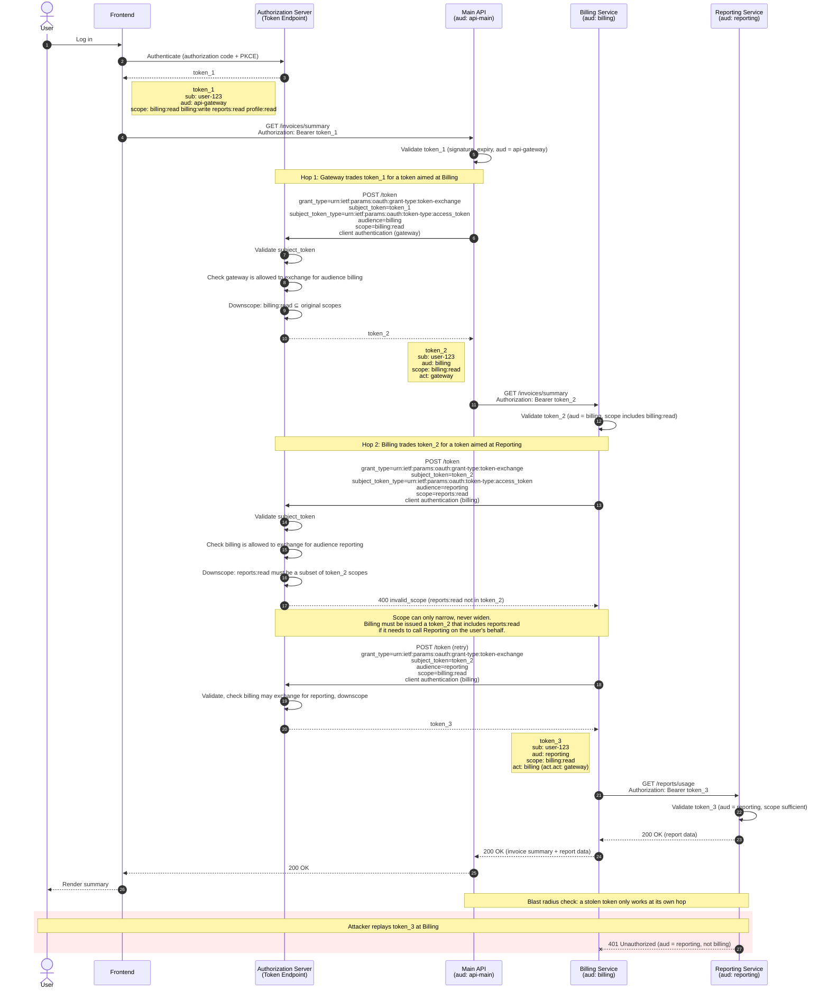

Token exchange is the [standard OAuth grant](/articles/oauth/complete-list-oauth-grants#oauth-20-token-exchange-grant) that lets you provide an access token to an authorization server and have that authorization server issue a new token in return. It also may support another kind of OAuth or SAML token, depending on implementation.

The token exchange defines a set of parameters which define, among other things, the type of token presented and the token iteself. It also includes what the returned token will look like. It also includes standard claims such as the `client_id`, the identifier of the client making the exchange and `act, a compound claim containing the party to which delegation has occurred.

Token exchange is what you reach for when a token you already have is the wrong shape for the place you need to use it. Say a user logs in and your frontend gets an access token for your main API. That API calls a billing service, which calls a reporting service, and each of those wants a token with its own audience and only the scopes it needs. You could pass the original token all the way down. 

And plenty of people do, which is how you end up with one stolen token that works everywhere. Or you could have each service trade the token it received for a narrower one aimed at the next hop, so the user’s identity travels with the request but the blast radius doesn’t. That’s the delegation case. There’s also the impersonation case, where a support tool acts as the user, and the cross-domain case, where you swap a token from one identity provider for one your own system understands.

I’ll be honest, it’s a feature most teams don’t need until they need it, and then they need it badly. If you have a monolith and a single API, you can ignore it. Once you have services calling services on behalf of users, you’re making a choice whether you realize it or not: either you’re exchanging tokens deliberately, or you’re forwarding whatever you were handed and hoping nobody downstream is compromised. So when your reporting service gets a request, do you actually know whether the token it’s holding was ever meant for it?

## AI AI AI

How does token exchange matter for AI? Many AI use cases I see right now come down to an agent doing something on a user’s behalf in a system that isn’t the agent: read my calendar, file a ticket, pull a record from the CRM. 

MCP is most of the plumbing for those interactions, and I think it’s useful (I’m a little bit cynical about the hype, but the problem is real). But MCP specifies that you shouldn't pass the token from the MCP server to downstream services. You want to [avoid token passthrough](https://modelcontextprotocol.io/docs/2026-07-28/tutorials/security/security_best_practices#token-passthrough).

Every MCP tool call is an authorization decision. Whose identity is the agent using, and does its token grant access to one calendar or everything that user can touch? 

My guess is a lot of MCP servers are handing the agent a broad token based on the user's authority because it was the fastest way to get the demo working. 

This mean if your agent got talked into doing something it shouldn’t have, what’s the worst thing its token lets it do? This is where token exchange comes in. Even if you aren't using MCP and are using direct API calls, having auditable, policy driven token exchange can help decrease the blast radius of any credential leakage.

## Three use cases, one RFC

If you look at [the RFC](https://www.rfc-editor.org/rfc/rfc8693), there are multiple use cases outlined. 

The first is impersonation. Impersonation is where you are acting as somebody else and the token still looks like that person's. But there are markings on the token that say "actually, this is somebody else." The canonical use case is a customer service rep who says to the authorization server "I have permission to act as Dan Moore in this application, please give me a token that lets me do that." The reason you don't just use a plain token like the user has is you want to be able to record that the customer service rep is who is acting in the application.

The second is cross-domain token translation. This is where you get a token from one trust domain, say a partner’s identity provider or a different cloud’s issuer, and trade it for one your own system will actually accept. You’re basically translating identity across a boundary, which sounds neat. Buth then you realize you’ve also got to decide how much you trust the party on the other side to have vouched for that user in the first place.

The third use case is delegation. In that case, you have a second entity that is explicitly delegated by the user to go do things, and it has a separate identity. An example of this is an AI agent that does things on behalf of Dan Moore, but isn't acting *as* Dan Moore. In the delegation case you might have downscoped access. In the impersonation case you're not going to downscope, because to troubleshoot any issues, your customer service agent needs to see exactly what Dan Moore sees.

I don't know why they mixed those use cases together in the same RFC; I haven't gone back and looked at the mailing list archives. They are related, but I find it confusing. It does point out the power of this relatively simple specification that there are so many uses for it.

## Delegation is the interesting part

I want to spend more time talking about delegation, because that's what I find more interesting, especially right now. There are three topics worth thinking about here, and the RFC omits them.

First, I think this is true of RFCs in general. They're fantastic for defining interfaces and for interoperability, but there's implementation detail that's necessarily left out of an RFC. But the implemenation details are really important. It's like the [authentication part of OAuth](/articles/oauth/why-no-authentication-in-oauth) or user provisioning for OIDC. These are sometimes left to the implementor, or other times are defined in other standards like SCIM.

Here's an example token exchange showing delegation and downscoping.

With respect to RFC 8693, there are two interesting holes in the specification that need to be built for a useful service.

* the policy engine that makes the delegation decision
* the audit trail that tracks decisions

### The policy engine

The policy engine is what determines what happens when you present a token to an authorization server. You might say, "Hey, I have this token that I somehow got, and I want to exchange it for a new token with a different audience and different attributes."

The RFC explicitly outlines the existence of such policy, but doesn't dictate anything about how it is arrived at. From section 2.2.1:

> If the request is valid and meets all policy and other criteria of the authorization server, a successful token response is constructed...

There are three possible answers from the rules the policy engine enforces:

1. **No.** The authorization server says you cannot exchange this token for this particular audience, with these attributes.
2. **Yes.** Here is the token with what you asked for.
3. **Yes, but.** You'll get a token, but some of the attributes will change. Maybe it expires sooner, or the permissions encapsulated in the token get downscoped.

Capturing this logic in a way that makes sense, that's easy to administer, and that's flexible is not discussed by the RFC. But it's crucial to the usefulness of the token exchange.

At FusionAuth we've approached this in two different ways.

The first is letting you use logic encoded in JavaScript. This follows the [lambda pattern](/docs/extend/code/lambdas/), one of our preferred extensoin methods. You write code that gets all the attributes of the incoming token and of the client, and then you decide which of the three outcomes to deliver. This lambda code can also call out to an [external API](/docs/extend/code/lambdas/lambda-remote-api-calls) if necessary, so you can put your decision point in an external shared system, such as FusionAuth FGA, and reuse that logic outside of token exchange as well. You can also [test](/docs/extend/code/lambdas/testing) and automate installation of the lambda code using CI/CD.

The second option leverages [entities](/docs/get-started/core-concepts/types/entity-management). You build up a network graph of audiences and use that to achieve all three outcomes. This approach lets you achieve all three outcomes, but it doesn't require you to write any logic, you just configure your different entities and the grants between them. If you use [Terraform](https://registry.terraform.io/providers/FusionAuth/fusionauth/latest/docs/resources/entity_grant) or similar to record the entity grants, you get an auditable record of the graph. 

Anybody implementing token exchange needs to grapple with the policy rules. You can push the decisions to the customer, you can set up basic rules, or you can set up a more complex solution like those outlined above. But you need to figure out how the authorization server is going to serve one of those three outcomes whenever a client asks for a token exchange.

### The audit trail

Okay, you have a decision from the policy engine. Next, make sure you're recording that decision. Because token exchange is used by AI agents and other software, auditing needs to perform well.

We added a non-standard parameter that makes the exchange audit log more useful. You can submit an `intent` parameter as part of the token exchange. That's captured in the audit log. In particular, we're thinking about the AI use case, where an AI agent can put its intent into the token exchange request. You don't have to use it, but it's helpful to examine. For instance, if an AI agent is continually asking for a wider set of scopes, you can review the audit log and see what scopes it is asking for. This allows you to manually or automatically change the policy engine. Maybe you do want to give it that additional scope, but that decision is informed by the audit log and enforced by deterministic controls around your software, not an AI agent "asking" for something.

Regardless, you need a token exchange audit log that captures every request. Make sure this is captured before the token is issued. Capture details about the request, the audiences needed, and the policy decision made. You want to record it locally and have it queryable, but you also want to have it ingested into your SIEM system. The latter allows you to correlate actions across a variety of identities.

## Wrapping up

The policy engine and audit trail are what make token exchange an improvement from other solutions FusionAuth offers such as the [JWT Vend API](/docs/apis/jwt#vend-a-jwt). Basically, to securely use the vend API, you needed to provide this functionality, so if you are using it, evaluate if the token exchange can replace it and simplify your system.

When you are building a system where you need to downscope or limit access, seek a zero trust environment, and want to leverage your authorization server as a system of record and a decision point, token exchange can be a very useful option.
