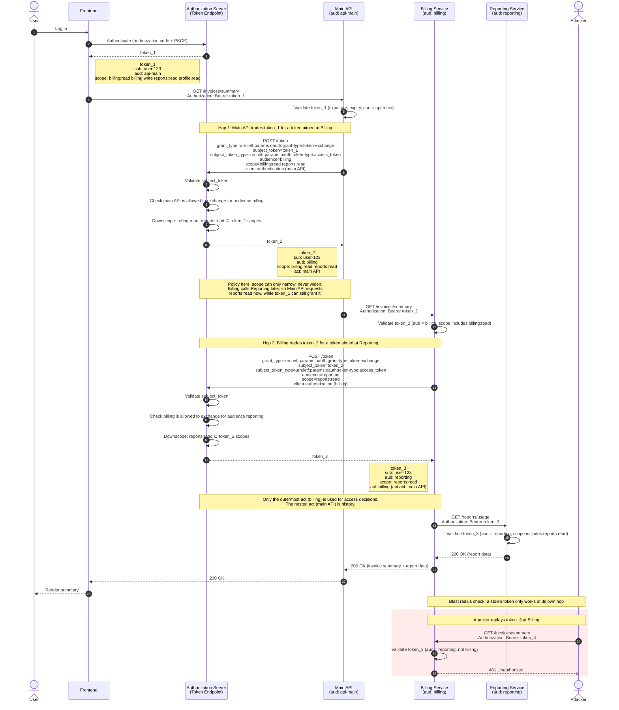

Token exchange is what you reach for when a token you already have is the wrong shape for the place you need to use it.

{/* more */}

Say a user logs in and your frontend gets an access token for your main API. That API calls a billing service, which calls a reporting service, and each of those wants a token with its own audience and only the scopes it needs. You could pass the original token all the way down. And plenty of people do, which is how you end up with one stolen token that works everywhere. Or you could have each service trade the token it received for a narrower one aimed at the next hop, so the user’s identity travels with the request but the blast radius doesn't. This trade is not cost-free since it adds latency at the same time as it increases security.

That trade is what the token exchange defines. Token exchange is a [standard OAuth grant](/articles/oauth/complete-list-oauth-grants#oauth-20-token-exchange-grant) that lets you provide a token to an authorization server and have that authorization server issue a new token. The token exchange defines a set of parameters which define, among other things, the type of token presented and the token itself. It includes what the returned token will look like. It also includes standard claims such as the `client_id`, the identifier of the client making the exchange and `act`, a compound claim containing the party to which delegation has occurred.

I’ll be honest, token exchange is a feature most teams don’t need until they need it, and then they need it badly. If you have a monolith and a few APIs, ignore it. Once you have services calling services on behalf of users, you’re making a choice whether you realize it or not: either you’re exchanging tokens deliberately, or you’re forwarding whatever you were handed and hoping nobody downstream is compromised. So when your reporting service gets a request, do you actually know whether the token it’s holding was ever meant for it?

## Multiple use cases, one RFC

If you look at [RFC 8693](https://www.rfc-editor.org/rfc/rfc8693), there are multiple use cases outlined. 

The first is impersonation. Impersonation is where you are acting as somebody else and the token still looks like that person's. The canonical use case is a customer service rep who says to the authorization server "I have permission to act as Dan Moore in this application, please give me a token that lets me do that." The identity system may record the impersonation exchange, but the token looks just like that which would be obtained by the original user.

The second use case is delegation. In that case, you have a second entity that is explicitly delegated by the user to go do things, and it has a separate identity. An example of this is an AI agent that does things on behalf of Dan Moore, but isn't acting *as* Dan Moore, as outlined above. In the delegation case you might have downscoped access and an `act` claim for delegation history.

There's also an third use case mentioned less prominently in the RFC. This is cross-domain token translation, where you get a token from one trust domain, say a partner’s identity provider or a different cloud’s issuer, and trade it for one your own system will actually accept. You’re basically translating credentials across a trust boundary, which sounds neat. But then you realize you’ve also got to decide how much you trust the party on the other side to have vouched for that user in the first place.

## AI AI AI

How does token exchange matter for AI? Many AI use cases I see right now come down to an agent doing something on a user’s behalf in a system that isn’t the agent: read my calendar, file a ticket, pull a record from the CRM. 

MCP is most of the plumbing for those interactions, and I think it’s useful (I’m a little bit cynical about the hype, but the problem is real). But MCP specifies that you shouldn't pass the token from the MCP server to downstream services. You want to [avoid token passthrough](https://modelcontextprotocol.io/docs/2026-07-28/tutorials/security/security_best_practices#token-passthrough).

Every MCP tool call is an authorization decision. Whose identity is the agent using, and does its token grant access to one calendar or everything that particular user can touch? 

My guess is a lot of MCP servers are handing the agent a broad token based on the user's authority because it was the fastest way to get the demo working. 

If your agent got talked into doing something it shouldn’t have, what’s the worst thing its token lets it do? This is where token exchange comes in. Even if you aren't using MCP and are using direct API calls, having auditable, policy-driven token exchange can help decrease the blast radius of any credential leakage.

## Delegation is the interesting part

I want to spend more time talking about delegation. 

Here's an example token exchange showing delegation and downscoping.

With respect to RFC 8693, there are a few interesting holes in the specification that need to be built for a useful service. (I think this is true of RFCs in general. They're fantastic for defining interfaces and for interoperability, but there's implementation detail that's necessarily left out of an RFC. But the implementation details are really important. It's like the [authentication part of OAuth](/articles/oauth/why-no-authentication-in-oauth).)

* the trust policy between the exchanger, the subject and the actor
* the policy engine that makes the delegation decision
* the audit trail that tracks decisions

### The trust policy

The trust policy between the exchanger, the subject and the actor is complicated to represent. This is the main reason FusionAuth doesn’t support `actor_token` for the initial release of the token exchange. When the actor is a separate token, the authorization server has to reason about three parties: the exchanger making the request, the subject whose authority is being used, and the actor named in the token. That means three trust relationships to decide:

* Can this client exchange this subject’s token?
* Can this client present this actor?
* Can this actor act for this subject at all?

Each one is another place for the policy to be wrong, more complexity to model, and another thing for an administrator to configure and audit.

Using the authenticated client as the actor collapses that to two parties and one question: is this client allowed to act on behalf of this subject, for this audience and resource? The `act` claim contains whoever authenticated, so there’s nothing to cross-check and no way to claim an identity the caller can’t prove. This works for many situations, such as an MCP server calling an API on behalf of a user.

The actor is always a client (an entity in FusionAuth's implementation), so an agent that needs to show up in `act` needs its own client identity rather than riding on a shared service’s credentials.

We think that’s the right default, because it keeps the policy small enough to reason about and supports many use cases.

### The policy engine

The policy engine is what determines what happens when you present a token to an authorization server. You might say, "Hey, I have this token that I somehow got, and I want to exchange it for a new token with a different audience and different attributes."

The RFC explicitly refers to policy decisions, but doesn't dictate anything about how they are arrived at. From [section 2.2.1](https://datatracker.ietf.org/doc/html/rfc8693#name-successful-response):

> If the request is valid and meets all policy and other criteria of the authorization server, a successful token response is constructed...

There are three possible answers from the rules the policy engine enforces:

1. **No.** The authorization server says you cannot exchange this token for this particular audience, with these attributes.
2. **Yes.** Here is the token with what you asked for.
3. **Yes, but.** You'll get a token, but some of the attributes will change. Maybe it expires sooner, or the permissions encapsulated in the token get downscoped.

Supporting this logic in a way that makes sense, that's easy to administer, and that's flexible is critical, but not covered by the RFC. At FusionAuth we've approached this in two different ways.

The first is to allow code to make the decision. This follows the [lambda pattern](/docs/extend/code/lambdas/), one of our preferred extension methods. You write code that gets all the attributes of the incoming token and of the client, and then you decide which of the three outcomes to deliver. This lambda code can also call out to an [external API](/docs/extend/code/lambdas/lambda-remote-api-calls) if necessary, so you can leverage an external shared authorization system, such as FusionAuth FGA. An external system lets you reuse that logic beyond the token exchange across other systems. With lambdas, you can [test](/docs/extend/code/lambdas/testing) the code too.

The second option leverages [entities](/docs/get-started/core-concepts/types/entity-management) to build a permission graph. The network graph of entities and grants dictates whether a token exchange can occur. This approach doesn't require you to write any code, just configuration. If you use [Terraform](https://registry.terraform.io/providers/FusionAuth/fusionauth/latest/docs/resources/entity_grant) or similar to record the entity grants, you have an auditable record of the graph. 

Anybody implementing token exchange needs to grapple with how to represent the policy and which token exchanges are allowed. You can push the decisions to the customer, you can set up basic rules, or you can set up a more complex solution like those outlined above. But RFC 8693 implementers must figure out how the authorization server determines one of those three outcomes whenever a client asks for a token exchange.

### The audit trail

Once you have a decision from the policy engine, you need to make sure you're recording that decision. Because token exchange is used by AI agents and other software, the auditing needs to scale to many requests per second. FusionAuth added a new token exchange log with all kinds of details, including audiences needed, token details, and the policy decision made. Here's an example screenshot:

We also added a non-standard parameter, `intent`. An AI agent can put its intent into the token exchange request. This parameter is not available to the policy engine because `intent` should not be used to determine if an exchange is allowed. It is captured in the audit trail to help you after the fact. If an AI agent is continually asking for a wider set of scopes that are refused by the policy engine, you can see the intent behind the requests in the audit log. Perhaps it is because the action it is trying to take requires write access. You can then change the policy engine configuration. Maybe you do want to give it that additional scope, but that decision is informed by the audit log and enforced by deterministic controls around your software, not an AI agent simply asking.

Whether you use the `intent` parameter or not, you need a token exchange audit log that captures every request. This audit log must be durable and captured before the token is issued; the system should fail closed and not grant a token if the audit log can't be written. You want to record it locally and have it queryable, but you also want it sent to your SIEM. The latter allows you to correlate actions across a variety of identities.

## What RFC implementations need

The trust decisions, policy engine and audit trail are all needed to make the exchange mechanism safe and useful. The RFC acknowledges the trust decision and the policy decision, but specifies none of these mechanisms in detail.

The policy engine and audit trail are also what make token exchange an improvement over other solutions FusionAuth offers such as the [JWT Vend API](/docs/apis/jwt/vend-a-jwt). Basically, to securely use the vend API, you needed to provide policy decisions and auditing. If you are using that solution, evaluate whether the token exchange can replace it and simplify your system.

As I mentioned at the beginning, not every system needs the token exchange. Here’s the test. If your reporting service were compromised today, what could the attacker do with the token it’s holding? Token exchange doesn’t make that question disappear, but it does mean the answer is “read some reports” instead of “anything the user could do.”

And if someone did try for more, who would find out?
