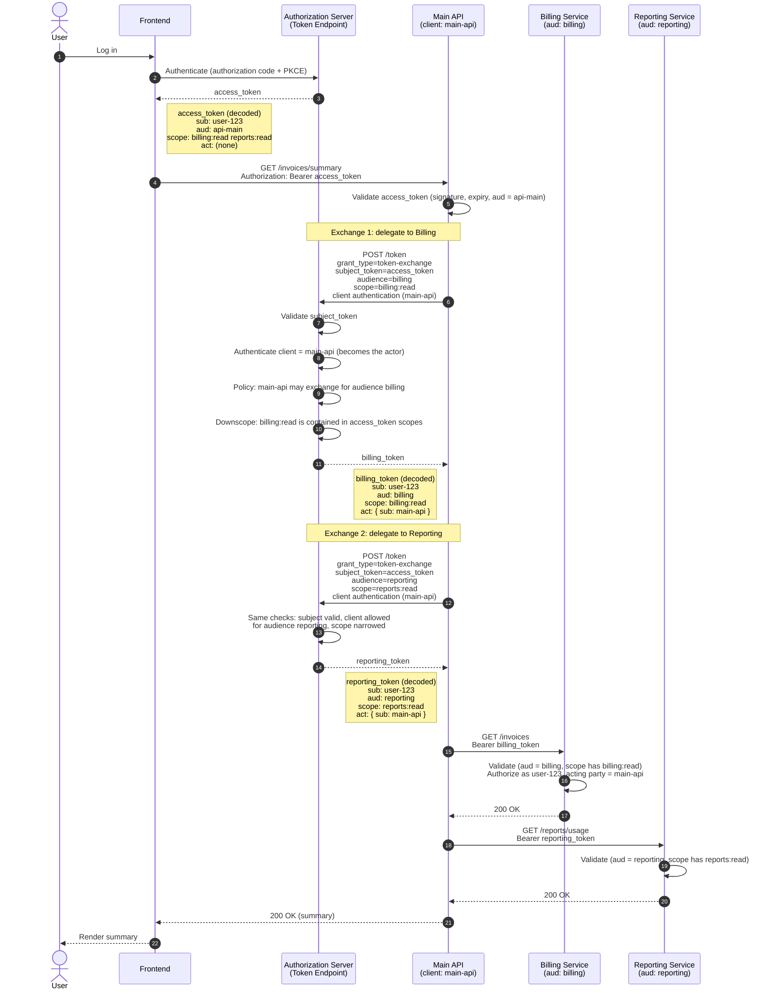

Token exchange is what you reach for when a token you already have is the wrong shape for the place you need to use it.

{/* more */}

Say a user logs in and your frontend gets an access token for your main API. That API calls a billing service and a reporting service, and each of those wants a token unique to it with just the permissions it needs.

You could pass the original token all the way down. And plenty of people do, which is how you end up with one stolen token that works everywhere. Or the caller could trade the token for a narrower one for each service it calls. The user’s identity travels with the request but the blast radius doesn't. This trade is not cost-free since it adds latency and a dependency on the component performing it, but it also increases security and decouples system components.

Token exchange solves this. It is a [standard OAuth grant](/articles/oauth/complete-list-oauth-grants#oauth-20-token-exchange-grant) that lets you provide a token to an authorization server and have that authorization server issue a new token. The token exchange standardizes a set of parameters which define, among other things, the type of token presented, the desired target service, and information inside the token, called claims. The resulting token includes standard claims such as the `client_id`, the identifier of the client making the exchange, and `act`, a compound claim containing the party to which delegation has occurred.

So how do you know if you should implement token exchange in your stack?

* If you have a monolith and a few APIs, you won't benefit much from token exchange.
* If your services call other services on their own or on behalf of users, token exchange tightens security and makes it easier to understand request flows.

## Multiple use cases, one RFC

[RFC 8693](https://www.rfc-editor.org/rfc/rfc8693) outlines multiple use cases.

* **Impersonation**: you act as somebody else, so the token looks like one obtained by that person, with no `act` claim. Think of a customer service rep who says to the authorization server "I have permission to act as Dan Moore in this application, please give me a token that lets me do that."
* **Delegation**: you have a second, separate entity that is explicitly delegated by the user to go do things. Imagine an AI agent that does things _on behalf of_ Dan Moore. This case might have downscoped access and an `act` claim for delegation history.

**Cross-domain token translation** is mentioned less prominently in the RFC. Here, you trade a token from one trust domain (e.g. a partner’s identity provider) for one your own system accepts. This translates credentials across a trust boundary. But you need to decide how much you trust the party on the other side to have vouched for that user in the first place.

## Delegation is the interesting part

I want to spend more time talking about the delegation use case. Here's an example token exchange showing delegation and downscoping.

The frontend’s access token was issued for the Main API only. Each token carries a field naming the service it’s meant for (called the audience), and Billing and Reporting would reject a token whose audience is someone else.

So when the Main API needs data from those services, it asks the authorization server for a new token. It proves its own identity to the authorization server, hands over the user’s token as proof that a real user is behind the request, and says which service it wants to call and what permissions it needs there.

Before issuing anything, the authorization server checks three things:

* The user's token is genuine and hasn’t expired.
* The Main API is allowed to request tokens for that particular service.
* The permissions requested are no broader than the ones the user's token already has.

Together, these checks are what I’ll call the policy engine, which we'll cover more below.

If all three pass, the new token has three important properties:

* It still identifies the same user. (The user is stored in a field called `sub`, short for subject.)
* It works only at the target service. (That’s the audience field.)
* It carries the same or a smaller set of permissions than the original.
 
The new token also records that the Main API is the one acting for the user, in a field called `act`, short for actor. A downstream service can read it and see both who the request is for and who is making it. In this example, the party asking for the exchange and the party recorded as the actor are the same: Main API. The spec lets you name a separate actor, but you don’t have to, and collapsing the two keeps things simpler. I’ll come back to this tradeoff below.

The payoff is that each service accepts only tokens meant for it. If an attacker steals the billing token, it won’t work at the Reporting Service, and the reverse is also true.

## AI AI AI

How does token exchange matter for AI? Many AI use cases I see right now come down to an agent doing something on a user’s behalf in a system where the user has an identity but the agent does not: read my calendar, file a ticket, pull a record from my CRM. 

The model context protocol (MCP) is the plumbing for those interactions. I’m a little cynical about the hype around MCP, but the problem it solves is real: letting AI agents securely access data. The MCP site specifies that you shouldn't pass the token from the MCP server to downstream services. You want to [avoid token passthrough](https://modelcontextprotocol.io/docs/2026-07-28/tutorials/security/security_best_practices#token-passthrough).

So, every MCP tool call is an authorization decision. Whose identity is the agent using, and does its token grant access to one calendar or everything that particular user can touch? 

My guess is a lot of MCP servers are handing the agent a broad token based on the user's authority because it was the fastest way to get the demo working. 

If your agent got talked into doing something it shouldn’t have, what’s the worst thing its token lets it do? Without delegation, a misbehaving agent can do anything the user can do. Token exchange shrinks that possible damage to what this one task needs. Even with direct API calls instead of MCP, auditable, policy-driven exchange limits the damage from a leaked credential.

## What's missing

With respect to RFC 8693, there are a few interesting holes in the specification that need to be filled out to deliver a useful service: 

* the trust policy between the exchanger, the subject and the actor
* the policy engine that makes the delegation decision
* the audit trail that tracks decisions

Aside: I think this is true of RFCs in general. They're fantastic for defining interfaces and for interoperability, but there's implementation detail that's necessarily left out of an RFC. But the implementation details are really important. It's like the [authentication part of OAuth](/articles/oauth/why-no-authentication-in-oauth); critical but undefined.

### The trust policy

If you implement everything in the RFC for delegation, there are three parties as well as the authorization server involved in getting a new token. If you think about Dan delegating access to an AI agent to make a request of an API, they are:

* the subject: Dan, who is granting authority
* the actor: the AI agent, seeking the delegated authority
* the exchanger: the software that actually makes the request for the new token, such as an MCP gateway

The authorization server has to enforce three trust relationships. There are three questions to answer:

* Can this exchanger exchange this subject's token (Dan)? 
* Can this exchanger present this actor (the AI agent)?
* Can this actor (the AI agent) act for this subject (Dan)?

Each is an opportunity for policy to be wrong, more complexity to model, and another thing for an implementor to configure and audit.

One option to simplify the exchange is to collapse the client and actor. This is spec compliant and simplifies the trust policy. Now you have two parties and one question: is this client allowed to act on behalf of this subject?  This works for many situations.

The downside is that the actor now must always be a client. Anything that needs to show up in `act` needs its own client identity. In other cases, you may want the actor to ride on a shared service's credentials. An MCP gateway proxying requests from multiple AI agents is an example. Each agent would be an actor, but the exchanger would be the MCP gateway.

### The policy engine

The policy engine determines what happens when you present a token to an authorization server in hopes of an exchange. You say "Hey, I have this token that I somehow got, and I want to exchange it for a new token with a different audience and different attributes."

The RFC explicitly refers to policy decisions, but doesn't dictate anything about how they are arrived at. From [section 2.2.1](https://datatracker.ietf.org/doc/html/rfc8693#name-successful-response):

> If the request is valid and meets all policy and other criteria of the authorization server, a successful token response is constructed...

There are three possible answers from a policy engine:

1. **No.** The authorization server says you cannot exchange this token for this particular audience, with these attributes.
2. **Yes.** Here is the token with what you asked for.
3. **Yes, but.** You'll get a token, but some of the attributes will change. Maybe it expires sooner, or the permissions in the token get downscoped.

It's critical to support this logic in a way that makes sense, that's easy to administer, and that's flexible. All RFC 8693 implementers must figure out how the authorization server determines one of those three outcomes, but the RFC doesn't explain how to do that. At FusionAuth we've approached this in two different ways, using code in a lambda and a graph of entities and grants. 

### The audit trail

Once you have a "no"/"yes"/"yes, but" decision from a policy engine, make sure you're recording what happened for every exchange request. Because token exchange is used by AI agents and other software, the auditing must handle many requests. (Where 'many' depends on the size of your system.)

You also need to capture exchange details, such as:

* the instant the exchange was attempted
* the tenant in which the exchange occurred
* the client that initiated the exchange
* claims from the subject token 
* the issuer of the subject token
* whether the subject token is valid
* the requested target audience(s)
* the audience(s) in the issued token
* the scopes in the issued token
* time taken for the policy engine check
* the id of the issued token
* and of course the outcome value (success, policy denied, etc)

Retain these records for however long your compliance department wants, in whatever storage mechanism is appropriate.

## What RFC implementations need

You need understandable trust decisions, a policy engine, and an audit trail to make token exchange safe and useful. The RFC points at trust and policy decisions but leaves the mechanisms, and auditing, to you.

As I mentioned at the beginning, not every system needs token exchange. Here’s the test. If your reporting service were compromised today, what could the attacker do with the token it’s holding? Token exchange doesn’t make that question disappear, but it does mean the answer is “read some reports” instead of “anything the user could do.”

And if someone did try for more, who would find out?
