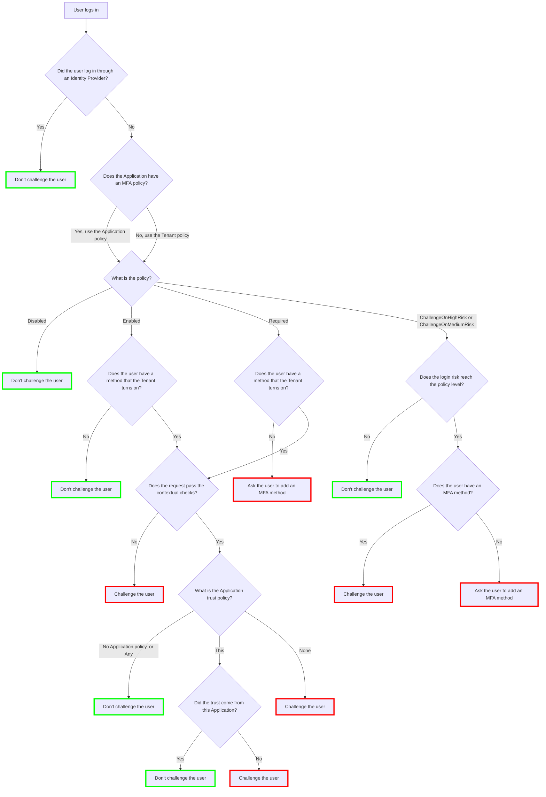

import { YouTube } from '@astro-community/astro-embed-youtube';
import ApplicationMfaPlans from 'src/content/docs/_shared/_application-mfa-plans.mdx';

At each login, FusionAuth decides whether to ask the user for a second factor. The decision depends on the MFA policy, the user's MFA methods, how the user logged in, and checks on the request. To turn on MFA methods and set the policy, see [Configure MFA](/docs/authentication/multi-factor-authentication/configure).

## When FusionAuth Asks for MFA

FusionAuth considers the following conditions for each login:

* Whether the user logged in through an Identity Provider, such as Google or OIDC. By default, FusionAuth doesn't ask for MFA after an Identity Provider login.
* The MFA policy of the Application, or of the Tenant when the Application has no policy.
* Whether the user has an MFA method that the Tenant turns on.
* For a risk-based policy, the risk of the login.
* Whether the request passes the contextual checks, such as a device that the user trusted at an earlier login, and the Application trust policy.

The following diagram shows how FusionAuth combines the conditions. A green outline marks an outcome without a challenge, and a red outline marks an outcome that asks the user for MFA or for a new MFA method:



A risk-based policy skips the contextual checks, so a trusted device doesn't skip the challenge when the risk reaches the policy level. An [MFA requirement lambda](#mfa-requirement-lambda) can change the outcome. For example, a lambda can challenge a user after an Identity Provider login, or under a risk-based policy when the risk is below the policy level.

### Contextual Checks

FusionAuth evaluates the following checks on every login request:

* Whether FusionAuth has seen the device before.
* Whether FusionAuth has seen the user on the device before.
* Whether FusionAuth detects a suspicious login. The suspicious login check requires the Enterprise plan.

The checks let FusionAuth skip the challenge when the risk of an attacker is low, and challenge when the risk outweighs the friction for the user. When a user selects the option to trust the device, the Tenant's **Two-Factor trust** duration controls how long the device skips the challenge. With the API, the duration is **`tenant.externalIdentifierConfiguration.twoFactorTrustIdTimeToLiveInSeconds`**.

Depending on your plan, you can set MFA policies on the Tenant and on each Application. For more information, see [License Limitations](#license-limitations).

### Tenant MFA Configuration

The Tenant policy applies to every Application in the Tenant that has no Application policy. The policy has the following values:

* `Disabled`: FusionAuth never asks for MFA at login.
* `Enabled`: FusionAuth asks for MFA when the user has an MFA method.
* `Required`: FusionAuth always asks for MFA. A user without an MFA method must add one.
* `ChallengeOnHighRisk` and `ChallengeOnMediumRisk`: FusionAuth asks for MFA based on the risk of the login. For more information, see [Intelligent MFA](#intelligent-mfa).

A Tenant with a policy other than `Disabled` must turn on at least one MFA method.

### Application MFA Configuration

<ApplicationMfaPlans />

An Application policy applies to logins to one Application, and always overrides the Tenant policy. The Application policy has the same values as the Tenant policy. Without an Application policy, the Tenant policy applies.

When the Application policy is `Enabled` or `Required`, the trust policy decides whether an earlier MFA challenge counts for the Application. The trust policy has the following values:

* `Any`: A challenge in any Application counts.
* `This`: Only a challenge in this Application counts.
* `None`: No earlier challenge counts, so FusionAuth challenges the user at every login.

The following table gives an example for each trust policy:

| Trust policy | Example Application | Reason |
|---|---|---|
| `Any` | An Application in a [suite of applications](/docs/concepts/patterns/app-suite), such as Google Drive, Google Calendar, and Gmail | The Applications share the same risk, so a challenge in any Application is enough. |
| `This` | A gambling Application with real money, in a suite with fantasy gaming Applications | A challenge in a fantasy gaming Application isn't enough for real money. |
| `None` | An internal admin dashboard | Access needs strict control, and friction for the user doesn't matter. |

## License Limitations

Your plan decides which MFA features you can use. For more information, see [Plans and Features](/docs/concepts/plans-and-limits/plans-features).

### Enterprise Plan

The following features require the Enterprise plan:

* Application MFA policies
* The suspicious login contextual check
* The MFA requirement lambda, including the risk score
* The impossible travel Intelligent MFA signal
* The client risk configuration

### Any Paid Plan

The following features require a paid plan:

* Email MFA
* SMS MFA
* Intelligent MFA policies
* Nine Intelligent MFA signals
* MFA enrollment on the self-service account pages

### Any Plan

The following features work on every plan:

* Authenticator app MFA
* Tenant MFA policies
* The MFA enrollment APIs
* An Application MFA policy for the FusionAuth Admin UI

## MFA Challenges After Identity Provider Login

FusionAuth doesn't ask for MFA after a login through an Identity Provider, such as Google or OIDC. FusionAuth trusts the Identity Provider to run its own MFA challenge. For more information, see [Account Security](/docs/authentication/identity-providers/#account-security).

To challenge Identity Provider logins anyway, add an [MFA requirement lambda](/docs/lambdas/login/mfa-requirement) that checks the `authenticationType` parameter.

## Intelligent MFA

<AvailableSince since="1.68.0"/>

<YouTube id="WwVH_ODLIJU" />

Intelligent MFA rates the risk of each login attempt as `LOW`, `MEDIUM`, or `HIGH`, from the [risk signals](/docs/security/account-protection/risk-signals) in FusionAuth. FusionAuth rates the risk at every login, whatever the policy. To act on the risk level, choose one of the following options:

* Set the login policy to `ChallengeOnHighRisk` or `ChallengeOnMediumRisk`.
* Read **`context.clientRisk.status`** in an [MFA requirement lambda](/docs/lambdas/login/mfa-requirement), and decide in the lambda.

A risk-based policy decides on the risk alone:

* When the risk is below the policy level, FusionAuth doesn't challenge the user, even a user with an MFA method.
* When the risk reaches the policy level, FusionAuth challenges the user, even on a trusted device. A user without an MFA method must add one before the login completes.

### Risk-Based Policies Without a License

Risk-based policies need a plan that includes Intelligent MFA. Without Intelligent MFA, FusionAuth treats a `ChallengeOnHighRisk` or `ChallengeOnMediumRisk` policy as `Required`. Users then get an MFA challenge at every login, whatever the risk.

FusionAuth rejects a risk-based Tenant policy when you save the Tenant without the license. A risk-based policy can still end up unlicensed in the following ways:

* You set a risk-based policy for the Admin UI at <Breadcrumb>Applications -> FusionAuth -> Multi-Factor</Breadcrumb>. MFA settings for the Admin UI skip the license check, so the Admin UI accepts a risk-based policy on any plan.
* Your license lapses or changes after you set a risk-based policy.

When your plan doesn't include Intelligent MFA, choose `Enabled` or `Required` for the Admin UI. The policy in the Admin UI then matches the policy that FusionAuth enforces.

### Roll Out Intelligent MFA

Intelligent MFA aims to challenge fewer legitimate users, while still challenging logins that look like an attacker or an account takeover. Every user population is different, so measure the effect before you apply a risk-based policy everywhere.

When your plan includes Intelligent MFA, the Tenant debug log shows the risk of every login without changing the MFA decision. Each log entry starts with `MFA challenge debug` and contains the user Id, the action, whether FusionAuth required a challenge, the composite risk, and the level of each risk signal. Use the log to measure first, then enforce:

1. Collect a baseline:
    * Turn on the `user.two-factor.challenge`, `user.two-factor.success`, and `user.two-factor.failed-attempt` webhooks, and count MFA challenges.
    * Calculate your current challenge rate, the number of MFA challenges per daily active user or per login. Get the daily active users from the [Reports API](/docs/apis/reports), or the logins from the [Login API](/docs/apis/login/export).
    * Count the MFA-related support requests.
1. Gather risk without changing behavior. Turn on **Debug Enabled** on the Tenant's <Breadcrumb>Multi-Factor</Breadcrumb> tab, and keep your current policy.
1. Capture the logs. Add an [event log create webhook](/docs/events/reference/event-log-create), keep only the `MFA challenge debug` entries, and store the user Id and the composite risk in a database.
1. Analyze the logs:
    * Compare the count of `HIGH` and `MEDIUM` ratings to the count of challenges in your baseline.
    * Review a sample of `HIGH` ratings for legitimate users, and a sample of `LOW` ratings for attackers.
    * Remember that a risk-based policy ignores trusted devices. A user who skips the challenge today on a trusted device gets a challenge when the risk reaches the policy level.
1. Pilot risk-based MFA in a small part of your system:
    * On the Enterprise plan, set a risk-based Application policy on one non-critical Application.
    * On other plans, set a risk-based policy on a low-traffic or internal Tenant.
    * Users without an MFA method must add one when the risk reaches the policy level, so expect new enrollments.
    * Keep reviewing the logs, and check that the challenge volume matches your estimate.
    * Compare the MFA-related support requests to the baseline, scaled by the share of logins in the pilot.
1. Widen the rollout:
    * Apply the policy to more Applications or Tenants, one at a time. Choose whether to challenge on high risk, or on medium and high risk.
    * On the Enterprise plan, handle exceptions in an MFA requirement lambda.
    * Turn off **Debug Enabled** when you trust the results.
1. Monitor the rollout:
    * Keep calculating the challenge rate and the challenge success rate.
    * After a Tenant has a risk-based policy, the Intelligent MFA dashboard counts failed, successful, and total challenges. To open the dashboard, navigate to <Breadcrumb>Plan & Features</Breadcrumb> and click <Breadcrumb>View dashboard</Breadcrumb> next to the Intelligent MFA dashboard.
    * Watch the **`threatsDetected`** value in the suspicious login webhook for trends.

To roll back, set the policy or the lambda back to the previous value.

### Example MFA Requirement Lambdas

The following MFA requirement lambda mimics the `Disabled` policy:

```javascript title="A lambda that mimics the Disabled policy"
function checkRequired(result, user, registration, context) {
  result.required = false;
}
```

The following lambda mimics the `Enabled` policy:

```javascript title="A lambda that mimics the Enabled policy"
function checkRequired(result, user, registration, context) {
  var methods = (user.twoFactor && user.twoFactor.methods) || [];
  result.required = methods.length > 0;
}
```

The following lambda mimics the `Required` policy:

```javascript title="A lambda that mimics the Required policy"
function checkRequired(result, user, registration, context) {
  result.required = true;
}
```

The following lambda mimics an Application policy. The lambda applies the Application policy, or the Tenant policy when the Application has none. When the policy requires a challenge, the lambda honors an unexpired MFA trust according to the Application trust policy. Start from this lambda when you need a custom rule on top of the standard policies:

<ExtractedCode src="example-lambdas/lambdas/mfa-requirement/application-policy.js" lang="javascript" title="A lambda that mimics an application MFA policy." />

### Client Risk Configuration

To leave a risk signal out of the Intelligent MFA risk calculation, navigate to <Breadcrumb>Tenants</Breadcrumb>, click <IconButton icon="edit" /> on the Tenant, and click the <Breadcrumb>Security</Breadcrumb> tab. In the **Client risk configuration** section, turn on **Customize risk signals**, and turn off each signal to leave out:

<Screenshot id="authenticate-tenant-security-client-risk-signals" url="/admin/tenant/edit/30663132-6464-6665-3032-326466613934#security" crop="#screenshot-band" cropPadding={0} alt="The Client risk configuration section of the Tenant Security tab, with a toggle for each risk signal." />

## Custom MFA Logic

The policies can't express every rule. For example, you might require MFA for every member of a group, or for users with a certain `user.data` field. To add a custom rule, use one of the following approaches.

### MFA Requirement Lambda

<PlanBlurb plan="enterprise" />

Navigate to <Breadcrumb>Customizations -> Lambdas</Breadcrumb> and create a lambda of type `MFA requirement lambda`. Then assign the lambda to the Tenant or the Application.

The following lambda requires MFA for members of one group, and for users with the `admin` or `billing-admin` role in the Application. Replace `replace-with-your-mfa-group-id` with the Id of your group:

<ExtractedCode src="example-lambdas/lambdas/mfa-requirement/require-for-admins.js" lang="javascript" title="A lambda that requires MFA for admins and members of a group." />

For more information, see [MFA Requirement Lambda](/docs/lambdas/login/mfa-requirement).

### Use a Webhook

To require MFA for every member of an `mfa_required` group without a lambda, follow these steps:

1. Set the Tenant or Application policy to `Enabled`. Then use the API to add an MFA method to every member of the `mfa_required` group.
1. Add a [transactional `user.update` webhook](/docs/events/reference/user/user-update) that rejects an update that removes the last MFA method of a user in the group.
1. Set the **Two-Factor trust** duration to your session length or less.
1. When you use an Application policy, set the trust policy to `This`.

### Redirect Users Through a Special Application

To challenge every member of an `mfa_required` group at every login, follow these steps:

1. Create an MFA check Application with the policy `Required` and the trust policy `None`.
1. After a user logs in, check the user's groups on an interstitial page in your application.
1. When the user is in the `mfa_required` group, redirect the user to the MFA check Application. FusionAuth challenges the user, then redirects the user back to your application.
1. When the user isn't in the group, send the user straight to your application.

The MFA check Application issues tokens with its own `aud` and `applicationId` claims. Add a [JWT populate lambda](/docs/lambdas/tokens/jwt-populate) to the MFA check Application that sets the claims your token consumers expect.

The approach works like a conditional step-up on the interstitial page, without the step-up APIs.

## MFA Challenges Outside of Login

To ask for MFA outside of login, such as before a money transfer, use step-up authentication with the [Start Multi-Factor API](/docs/apis/two-factor/start-multi-factor). For more information, see [Step-Up Authentication](/docs/authentication/multi-factor-authentication/step-up).

## Turn Off an MFA Method

When the Tenant turns off an MFA method, FusionAuth keeps the method on each user, but ignores the method at login:

* A user whose only methods the Tenant turns off logs in without an MFA challenge.
* A user with another method still gets the MFA challenge. FusionAuth can't send a code for a turned-off email or SMS method, and the method picker on the hosted login pages leaves the method out. A code from a turned-off authenticator method still completes the login.
* SMS and voice are two ways to deliver a code for the same phone method. When the Tenant turns off one of the two, FusionAuth sends codes the other way only. When the Tenant turns off both, FusionAuth ignores the phone method.

Users can't add a new method of a turned-off type. While the login policy isn't `Disabled`, the Tenant must keep at least one method on.

To remove the turned-off methods from users, find the users with the [Search for Users API](/docs/apis/users/search). For example, the `queryString` value `twoFactor.methods.method:email` finds every user with an email method. Then remove the method from each user. For more information, see [Disable MFA for a User](/docs/authentication/multi-factor-authentication/disable).
