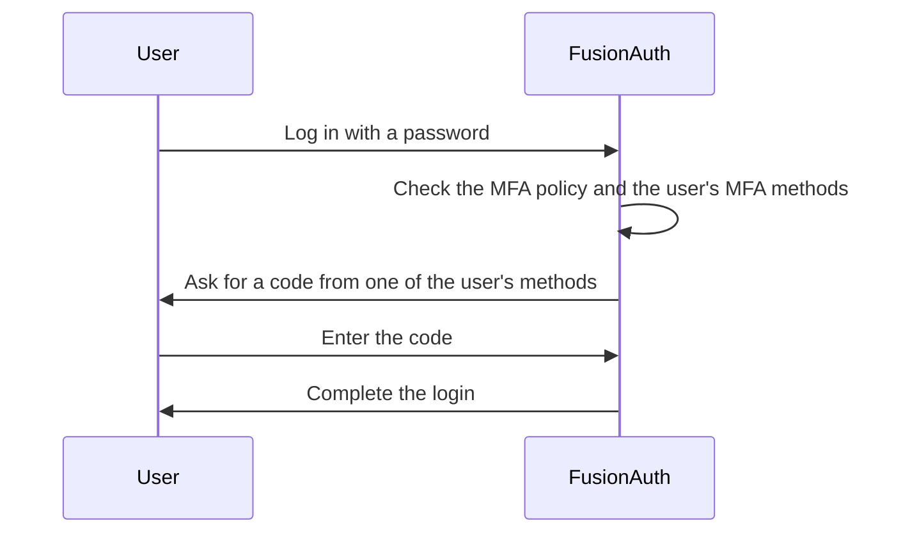

import { YouTube } from '@astro-community/astro-embed-youtube';

<YouTube id="GM2JPTu-EE4" />

[[Multi-Factor Authentication::Multi-factor authentication]] (MFA) asks a user for more than one proof of identity, called factors, before a login completes. A typical second factor is a one-time code from an email, a text message, or an [[authenticator app]]. [[Two-Factor Authentication::Two-factor authentication]] (2FA) is MFA with exactly two factors, usually a password and a code.

FusionAuth can ask for a second factor at login, and before a sensitive action through [[Step-Up Authentication::step-up authentication]].

## How MFA Works

The following diagram shows a login that requires a second factor:

After the password check, FusionAuth decides whether to challenge the user. The decision depends on the MFA policy of the Tenant or Application, the user's MFA methods, and checks on the request, such as whether the device is known. When FusionAuth challenges the user, the user enters a code from one of the user's methods, or a recovery code.

To set up MFA, follow these steps:

1. Turn on MFA methods and set the MFA policy. For more information, see [Configure MFA](/docs/authentication/multi-factor-authentication/configure).
1. Add MFA methods to users. For more information, see [Enable MFA for a User](/docs/authentication/multi-factor-authentication/enable).
1. Handle the MFA challenge at login. For more information, see [MFA at Login](/docs/authentication/multi-factor-authentication/login).

## Supported Methods

FusionAuth supports the following MFA methods:

| Method | Code delivery | Plan |
|---|---|---|
| Authenticator app | The user reads a [[Time-Based One-Time Password::time-based one-time password]] (TOTP) from an app such as Google Authenticator. | Any plan |
| Email | FusionAuth emails a code to the user. | Starter plan or higher |
| SMS | FusionAuth texts a code to the user's phone. | Starter plan or higher |
| Voice | FusionAuth calls the user's phone and reads a code. Available in FusionAuth `1.65.0` and later. | Starter plan or higher |

A user can have several methods, including several of the same type. For the user's side of each method, see [Authenticator App](/docs/users/account-management/two-factor-authenticator), [Email](/docs/users/account-management/two-factor-email), and [Phone](/docs/users/account-management/two-factor-phone). For the MFA features in each plan, see [License Limitations](/docs/authentication/multi-factor-authentication/contextual#license-limitations).

## When FusionAuth Asks for MFA

The MFA policy on the Tenant controls when FusionAuth asks for a second factor at login. On the Enterprise plan, an Application can set a policy that overrides the Tenant policy. The policy has the following values:

* `Disabled`: FusionAuth never asks for MFA at login.
* `Enabled`: FusionAuth asks for MFA when the user has an MFA method.
* `Required`: FusionAuth always asks for MFA. A user without an MFA method must add one before the login completes.
* `ChallengeOnHighRisk` and `ChallengeOnMediumRisk`: FusionAuth asks for MFA when [Intelligent MFA](/docs/authentication/multi-factor-authentication/contextual#intelligent-mfa) rates the login as risky.

By default, FusionAuth doesn't ask for MFA after a login through an Identity Provider, such as Google or OIDC. Except under a risk-based policy, a device that the user trusted at an earlier login skips the challenge. For the full decision logic, see [Contextual Multi-Factor Authentication](/docs/authentication/multi-factor-authentication/contextual). To ask for a second factor before a sensitive action, see [Step-Up Authentication](/docs/authentication/multi-factor-authentication/step-up).

## Recovery Codes

A recovery code lets a user who lost access to every MFA method log in. When a user adds a first MFA method, FusionAuth generates 10 [[Recovery Code::recovery codes]] and shows the codes to the user once. The user stores the codes in a safe place.

Recovery codes behave as follows:

* The user can enter a recovery code at any MFA challenge, in place of a code from an MFA method. The [[hosted login pages]] and the [Complete Multi-Factor Authentication API](/docs/apis/login/complete-mfa) both accept recovery codes.
* Each recovery code works once.
* FusionAuth generates codes only for the first method. Adding a second method doesn't change the codes.
* When the user disables MFA with a recovery code, FusionAuth removes every MFA method and every remaining recovery code. When the user adds a method again, FusionAuth generates 10 new codes.
* To replace a user's codes, call the [Generate Recovery Codes API](/docs/apis/two-factor/generate-recovery-codes). The API returns 10 new codes, and the old codes stop working.

The hosted login pages show recovery codes on the account pages and the OAuth MFA setup page. When you build your own pages, show the user the **`recoveryCodes`** from the [Enable Multi-Factor API](/docs/apis/two-factor/enable-multi-factor) response.

<Aside type="caution" title="Recovery codes are only available at generation">
In FusionAuth `1.68.0` and later, FusionAuth stores recovery codes as hashes. No API can retrieve the codes after FusionAuth generates the codes.
</Aside>

When you add a method with the User API, FusionAuth also generates recovery codes, but the User API doesn't return the codes. To give the user codes, call the Generate Recovery Codes API after you add the method.

## Trust Tokens and Trust Challenges

Some requests for a user with MFA need proof that the user passed an MFA challenge recently. The [Change Password API](/docs/apis/users/change-password) is the main example. The proof is a [[Trust Token::trust token]], which the [Complete Multi-Factor Authentication API](/docs/apis/login/complete-mfa) returns after a successful MFA challenge. The hosted login pages handle trust tokens for you.

When you build your own pages, get a trust token with the following steps:

1. Call the [Start Multi-Factor API](/docs/apis/two-factor/start-multi-factor). The response contains a **`twoFactorId`** and the user's MFA methods.
1. Ask the user for a code. For an email or SMS method, send the code first with the [Send a Multi-Factor Code During Login or Step Up API](/docs/apis/two-factor/send-a-multi-factor-code-during-login-or-step-up).
1. Call the Complete Multi-Factor Authentication API with the **`twoFactorId`** and the code. The response contains a **`trustToken`**.
1. Send the **`trustToken`** with the request that requires trust.

A stolen trust token works for anyone who holds the token. To bind the token to your server, set **`trustChallenge`** to a long random value in the start request. The trust token then works only with the same **`trustChallenge`**, so send both values to the Change Password API. When the start request has no **`trustChallenge`**, the trust token works alone.

The Tenant's **Trust token** duration controls how long a trust token stays valid. For an example with a password reset, see [Handle Users With MFA](/docs/users/account-recovery/api#handle-users-with-mfa).

## Other MFA Methods

When FusionAuth doesn't support the factor you need, consider the following options:

* For a factor that receives a code by message, such as push notifications, set up a [Generic Messenger](/docs/messengers/generic-messenger) and use the SMS method. FusionAuth sends the code to your service, and your service delivers the code.
* For a factor that delivers a code out of band, use [step-up authentication](/docs/authentication/multi-factor-authentication/step-up-api) with your own code. Step-up doesn't require the user to have an MFA method.
* For a factor that runs as a service, send a [transactional webhook](/docs/events/webhooks) for the `user.login.success` event. When the webhook returns a status other than `200`, the login fails. The user sees a generic error, and the check runs at every login. For an example, see [Locking an Account With a Breached Password](/blog/locking-an-account-with-breached-password).
* Build your own login pages with the [Login API](/docs/apis/login), and add your factor to the flow.
* Run an OpenID Connect server that handles your factor, and add an [OpenID Connect Identity Provider](/docs/authentication/identity-providers/) that points to the server. To make the Identity Provider the only way to log in, add a [Login Validation Lambda](/docs/lambdas/login/login-validation).

To request a new MFA method, see the [Roadmap](/docs/update/roadmap).

To move MFA methods from another system, see [Import MFA Methods](/docs/authentication/multi-factor-authentication/enable#import-mfa-methods). To update from FusionAuth `1.25` or earlier, see [`1.26.0` Multi-Factor Authentication](/docs/update/update-guides/1-26-0).
