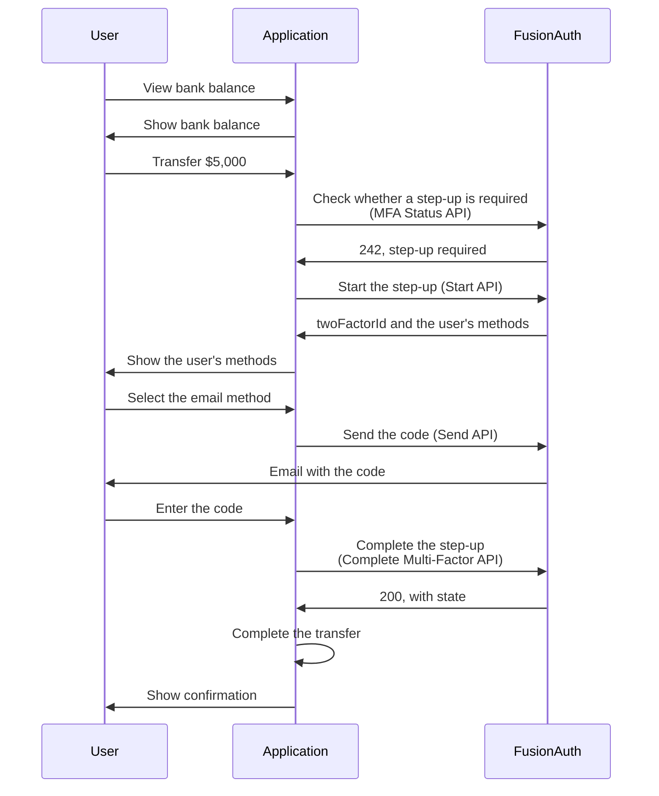

This guide adds a step-up challenge before a sensitive action in your application. The example is a banking application that requires a step-up before a transfer, but not when the user views a balance. For how FusionAuth decides when to require a step-up, and how long a step-up lasts, see [Step-Up Authentication](/docs/authentication/multi-factor-authentication/step-up).

## Prerequisites

* FusionAuth `1.62.0` or later, for the `POST` method of the MFA Status API.
* A FusionAuth API key with access to the `/api/two-factor` and `/api/two-factor/login` endpoints. For more information, see [API Keys](/docs/apis/authentication#managing-api-keys).
* At least one MFA method enabled on the Tenant. Without one, the MFA Status API never requires a step-up.
* A server-side session in your application that stores the logged in user's Id.

The steps below send codes by email. Sending codes through FusionAuth requires the Starter plan or higher. On any plan, you can deliver codes through your own channel instead.

The following diagram shows the flow:



## Check Whether a Step-Up Is Required

When the user starts a sensitive action, call the [MFA Status API](/docs/apis/two-factor/retrieve-multi-factor-status) with an **`action`** of `stepUp`. Put details about the action in **`eventInfo.data`**, so an MFA Requirement Lambda can read them:

```shell title="Check whether a step-up is required"
API_KEY=...
REQUEST_PAYLOAD='{...}'

curl -XPOST -H 'Content-type: application/json' -H "Authorization: $API_KEY" 'https://local.fusionauth.io/api/two-factor/status' -d "$REQUEST_PAYLOAD"
```

<JSON title="MFA Status request for a step-up" src="two-factor/status/step-up-request.json" />

When the API returns `200`, skip the remaining steps and complete the action. When the API returns `242`, continue to the next step.

### Skip Low-Risk Actions With a Lambda

<PlanBlurb plan="enterprise" />

When some actions don't need a step-up, add an [MFA Requirement Lambda](/docs/lambdas/login/mfa-requirement) to the Tenant. The following lambda skips the step-up for transfers under 100, and requires a step-up for everything else:

```javascript title="MFA Requirement Lambda that skips small transfers"
function checkRequired(result, user, registration, context) {
  if (context.action !== 'stepUp') {
    return;
  }

  var data = (context.eventInfo && context.eventInfo.data) || {};
  if (data.operation === 'transfer' && data.amount < 100) {
    result.required = false;
  }
}
```

The lambda returns early for the `login` and `changePassword` actions, so login MFA keeps the Tenant and Application policies.

## Start the Step-Up

Call the [Start Multi-Factor API](/docs/apis/two-factor/start-multi-factor):

```shell title="Start the step-up"
API_KEY=...
REQUEST_PAYLOAD='{...}'

curl -XPOST -H 'Content-type: application/json' -H "Authorization: $API_KEY" 'https://local.fusionauth.io/api/two-factor/start' -d "$REQUEST_PAYLOAD"
```

<JSON title="Start request for a step-up" src="two-factor/start/step-up-request.json" />

Set the request fields as follows:

* Put an identifier for the pending action in **`state`**, such as a transaction Id. FusionAuth returns **`state`** when the step-up completes, so your application can match the step-up to the action.
* When your application needs the [[Trust Token::trust token]] for the [Change Password API](/docs/apis/users/change-password), set **`trustChallenge`** to a long random value. The trust token then only works with the same challenge. For more information, see [Trust Tokens and Trust Challenges](/docs/authentication/multi-factor-authentication#trust-tokens-and-trust-challenges).
* When you deliver the code through your own channel, set **`code`** to your own value, or omit **`code`** and read the generated code from the response.

<JSON title="Start response" src="two-factor/start/response-with-methods.json" />

Store the **`twoFactorId`** in the user's server-side session. The `twoFactorId` expires after the Tenant's **Two-Factor** duration, five minutes by default. A new start request for the same user and Application cancels the previous `twoFactorId`.

Show the user the list of **`methods`** and ask the user to choose one. When **`methods`** is empty, the user has no MFA methods. Deliver the code through your own channel instead, and skip the next step.

## Send the Code

When the user chooses an `authenticator` method, skip this step. The user reads the code from the authenticator app.

When the user chooses an `email` or `sms` method, call the [Send API](/docs/apis/two-factor/send-a-multi-factor-code-during-login-or-step-up) with the method's **`id`** as **`methodId`**. The Send API needs no API key:

```shell title="Send the code"
REQUEST_PAYLOAD='{...}'
TWO_FACTOR_ID=... # from the start response

curl -XPOST -H 'Content-type: application/json' 'https://local.fusionauth.io/api/two-factor/send?twoFactorId='$TWO_FACTOR_ID -d "$REQUEST_PAYLOAD"
```

<JSON title="Send request" src="two-factor/send/step-up-request.json" />

The Send API replaces the code from the start request with a new code. Don't call the Send API when you deliver your own code.

## Complete the Step-Up

Build a page that collects the code. Then call the [Complete Multi-Factor Authentication API](/docs/apis/login/complete-mfa) with the code and the `twoFactorId`. Set **`noJWT`** to `true`, unless your application needs new tokens. Without **`noJWT`**, FusionAuth issues a new access token and refresh token for every step-up:

```shell title="Complete the step-up"
API_KEY=...
REQUEST_PAYLOAD='{...}'

curl -XPOST -H 'Content-type: application/json' -H "Authorization: $API_KEY" 'https://local.fusionauth.io/api/two-factor/login' -d "$REQUEST_PAYLOAD"
```

<JSON title="Complete request for a step-up" src="login/two-factor/step-up-request.json" />

The API returns one of the following status codes:

* `200` when the code is valid. The response includes the user, the **`state`** object, and a **`trustToken`**.
* `421` when the code is wrong. Ask the user to try again. Failed codes count toward [Account Lockout](/docs/security/account-protection/account-lockout).
* `404` when the `twoFactorId` has expired or was already used. Start a new step-up.
* `409` when the account is locked. Cancel the action.

For the full list of status codes, see the [Complete Multi-Factor Authentication API](/docs/apis/login/complete-mfa).

<JSON title="Complete response for a step-up" src="login/two-factor/step-up-response.json" />

## Complete the Sensitive Action

Before you complete the action, check the following in your application:

1. The **`user.id`** in the response matches the user in the server-side session.
1. The **`state`** in the response matches the pending action, such as the transaction Id.
1. When you allow a step-up to last for a window of time, record the time of the step-up in the server-side session.

Then complete the sensitive action.

## Confirm the Result

To confirm the step-up works, test the following cases:

1. Start a sensitive action and enter the correct code. The action completes.
1. Start a sensitive action and enter a wrong code. The API returns `421`, and the action doesn't complete.
1. Start a sensitive action, wait longer than the **Two-Factor** duration, and enter the code. The API returns `404`.
1. When you use an MFA Requirement Lambda, start a low-risk action. The MFA Status API returns `200`, and the user sees no challenge.
