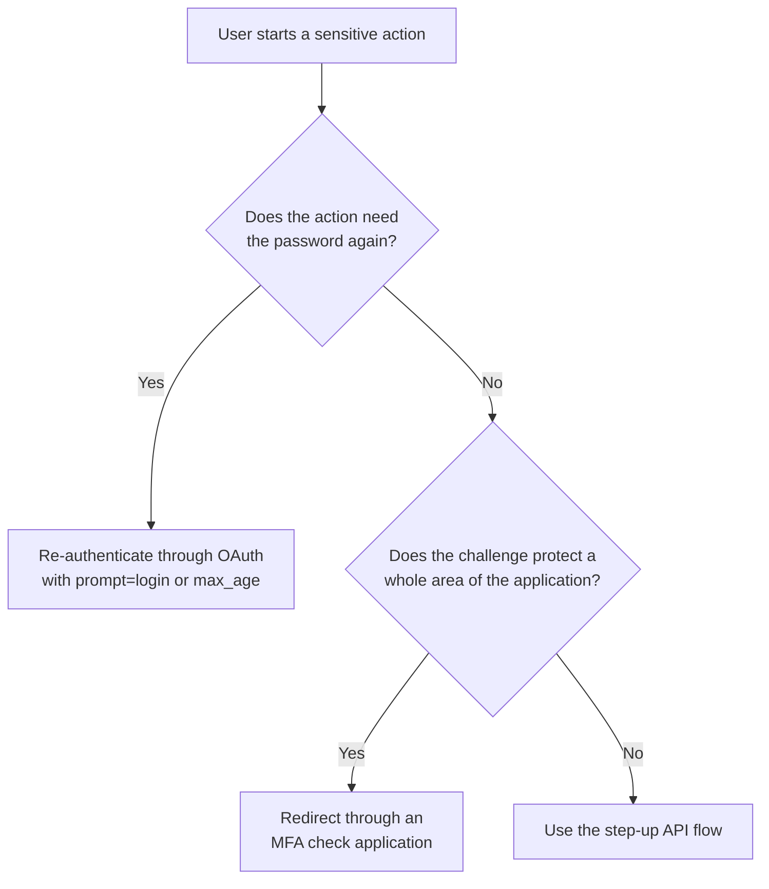

[[Step-Up Authentication::Step-up authentication]] asks a logged in user for another factor before a sensitive action, such as a money transfer, an email address change, or account deletion. Login MFA protects the session as a whole. Step-up protects one action at a time, so users only see the extra challenge when the action needs the extra assurance.

FusionAuth can't know which actions in your application are sensitive. Your application decides when to ask for a step-up, and FusionAuth provides the APIs to check, challenge, and verify the user.

To add step-up to your application, see [Add Step-Up With the API](/docs/authentication/multi-factor-authentication/step-up-api).

## Approaches

FusionAuth supports the following ways to challenge a logged in user again:

* The step-up API flow. Your application calls the [Two-Factor APIs](/docs/apis/two-factor) and shows the challenge in your own UI. Your application controls which actions need a step-up and passes details about each action to FusionAuth.
* Re-authentication through OAuth. Your application sends the user back to the [[Hosted Login Pages::hosted login pages]] with `prompt=login` or `max_age`. The user logs in again, with MFA when the login policy requires MFA. Your application then checks the `auth_time` claim in the new token. For more information, see [OIDC Prompt](/docs/authentication/oauth/prompt).
* An MFA check application. Your application redirects the user through a second FusionAuth Application with an MFA policy of `Required`. For more information, see [Redirect Users Through a Special Application](/docs/authentication/multi-factor-authentication/contextual#redirect-users-through-a-special-application).

The step-up API flow fits most sensitive actions, because the challenge only asks for a code and the user stays on the page. Re-authentication through OAuth asks for the password again, which suits actions such as a password change. The MFA check application suits a whole area of an application, such as an admin section, rather than a single action.

The rest of this page covers the step-up API flow.

## When FusionAuth Requires a Step-Up

Your application asks FusionAuth whether a step-up is required by calling the [MFA Status API](/docs/apis/two-factor/retrieve-multi-factor-status) with an **`action`** of `stepUp`. The API returns `242` when the user must complete a challenge, and `200` when the user can continue.

For the `stepUp` action, FusionAuth ignores the Tenant and Application MFA login policies, and requires MFA by default. FusionAuth then applies the following rules, in order:

1. When the Tenant has no MFA methods enabled, FusionAuth doesn't require a step-up.
1. When the user has no MFA methods, FusionAuth requires a step-up.
1. When the request includes a valid **`twoFactorTrustId`** for the user, FusionAuth applies the Application **`trustPolicy`**. A trust policy of `None` requires a step-up. A trust policy of `Any` or `This` skips the step-up while the trust is valid. Without an Application trust policy, the trust skips the step-up. For more information, see [Trusted Devices](#trusted-devices).
1. Otherwise, FusionAuth requires a step-up.

An [MFA Requirement Lambda](/docs/lambdas/login/mfa-requirement) can change the decision. For the `stepUp` action, FusionAuth always uses the lambda's result. The lambda receives the **`eventInfo.data`** object from the status request, so your application can pass details about the action, such as a transfer amount. The lambda can then skip the step-up for low-risk actions. MFA Requirement Lambdas require the Enterprise plan.

## What a Completed Step-Up Returns

The user completes a step-up through the [Complete Multi-Factor Authentication API](/docs/apis/login/complete-mfa), the same API that completes an MFA login. FusionAuth treats a completed step-up as a login:

* FusionAuth issues a new [[Access Token::access token]], and a new [[Refresh Token::refresh token]] when the Application generates refresh tokens. Set **`noJWT`** to `true` to skip both tokens.
* FusionAuth updates the user's **`lastLoginInstant`**, records a login, and sends a [`user.login.success`](/docs/events/reference/user/login/user-login-success) event.
* FusionAuth runs the Application's login validation and JWT populate lambdas.
* The response includes the **`state`** object from the start request, and a [[Trust Token::trust token]].

A step-up doesn't change the user's SSO session or existing tokens. The new access token also doesn't record the step-up: the **`authenticationType`** claim is `PASSWORD`, the **`amr`** claim is absent, and **`auth_time`** is the time FusionAuth issued the token. Your application can't tell a stepped-up token from a password login token by the claims alone.

Each `twoFactorId` works once. A new start request for the same user and Application cancels any step-up already in progress for that pair.

## How Long a Step-Up Lasts

FusionAuth doesn't track whether a user recently completed a step-up. Your application decides how long a step-up stays valid. Choose one of the following options:

* Ask for a step-up on every sensitive action. This option is the simplest and the most secure.
* Record the time of each completed step-up in your application's server-side session. Before the next sensitive action, compare the time to a window you choose, such as five minutes. Don't store the time in a client-side cookie or token that the user can change.
* Set **`trustComputer`** to `true` when the user completes the step-up, and pass the returned **`twoFactorTrustId`** in later status requests. An MFA Requirement Lambda then reads **`context.mfaTrust.startInstants.applications`** and skips the step-up within your window. This option needs the Enterprise plan.

### Trusted Devices

A **`twoFactorTrustId`** lasts for the Tenant's **Two-Factor Trust** duration, which defaults to 30 days. Configure the duration at <Breadcrumb>Tenants -> Your Tenant -> Advanced -> External identifier durations</Breadcrumb>.

<Aside type="caution" title="A trust can skip step-up for 30 days">
Without an Application **`trustPolicy`** or an MFA Requirement Lambda, a status request with a valid **`twoFactorTrustId`** returns `200` for the full trust duration. Don't pass a **`twoFactorTrustId`** in step-up status requests unless an MFA Requirement Lambda enforces your window, or the Application **`trustPolicy`** is `None`. Application MFA settings require the Enterprise plan.
</Aside>

## Users Without MFA Methods

A user doesn't need an MFA method to complete a step-up. The start response for a user without methods has an empty **`methods`** array. The [Send API](/docs/apis/two-factor/send-a-multi-factor-code-during-login-or-step-up) needs the Id of one of the user's methods, so the Send API can't deliver the code. Instead, pass your own **`code`** in the start request, or read the generated **`code`** from the start response. Then deliver the code through your own channel, such as the user's verified email address.

Alternatively, require users to enable an MFA method before the first sensitive action. For more information, see [Enable MFA for a User](/docs/authentication/multi-factor-authentication/enable).

## Failed Codes and Account Lockout

When the user enters a wrong code, FusionAuth returns `421`. Failed step-up codes count toward the Tenant's failed authentication settings, the same as failed passwords. When the count reaches the limit, FusionAuth locks the account and cancels every step-up in progress for the user.

<Aside type="caution" title="Failed step-ups lock the whole account">
The lockout applies to every login, not only to step-up. A user who fails several step-up challenges can't log in again until the lockout ends. For more information, see [Account Lockout](/docs/security/account-protection/account-lockout).
</Aside>

Without a lockout user action, FusionAuth applies the Tenant's failed login rate limit instead. FusionAuth doesn't limit attempts per `twoFactorId` beyond these settings.

## Plans

The MFA Status, Start, and Complete APIs work on every plan. The following features require a paid plan:

* Sending codes by email or SMS through FusionAuth requires the Starter plan or higher.
* MFA Requirement Lambdas require the Enterprise plan.
* Application MFA settings, including the Application **`trustPolicy`**, require the Enterprise plan.
