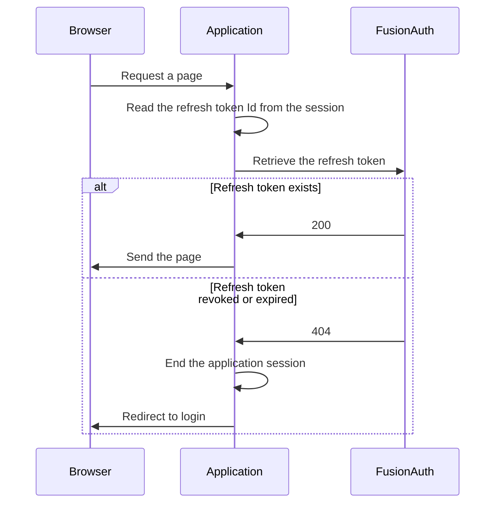

A [[centralized session]] ties each application session to a FusionAuth refresh token. Your application checks the refresh token on every request, so revoking the refresh token in FusionAuth ends the application session. To decide whether you need centralized sessions, see [Application Sessions](/docs/authentication/sessions/how-sessions-work#application-sessions).

The following diagram shows a request after a user logs in. The only difference from an application-managed session is the check against FusionAuth:

## Prerequisites

* An API key with `GET` and `DELETE` permissions on `/api/jwt/refresh`.
* An application that logs users in with the [Authorization Code grant](/docs/authentication/oauth/authorization-code) or the [Login API](/docs/apis/login).

## Turn On Refresh Tokens

For the hosted login pages, navigate to <Breadcrumb>Applications -> Your Application -> OAuth</Breadcrumb>. Turn on **Generate refresh tokens**, and select `Refresh Token` in **Enabled grants**.

For the Login API, navigate to <Breadcrumb>Applications -> Your Application -> Security</Breadcrumb>. Turn on **Generate refresh tokens** and **Enable JWT refresh**.

Click <Breadcrumb>Save</Breadcrumb>.

## Request a Refresh Token at Login

When your application builds the authorization URL, include `offline_access` in the **`scope`** parameter: `scope=openid%20offline_access`. Without `offline_access`, FusionAuth doesn't issue a refresh token.

The Login API returns a refresh token whenever the Application allows refresh tokens.

## Store the Refresh Token Id

The token endpoint response includes **`refresh_token_id`**. Store the Id in your application session or in an [[HttpOnly cookie]]. Store the Id rather than the token value, because the Id stays the same when FusionAuth rotates a one-time use refresh token.

## Check the Refresh Token on Each Request

Add middleware that retrieves the refresh token by Id with the [Retrieve Refresh Tokens API](/docs/apis/jwt/retrieve-refresh-tokens). When FusionAuth returns an error, the session ended in FusionAuth, so end the application session. Skip the check for public routes such as login and the OAuth callback:

<ExtractedCode lang="js" src="example-node-centralized-sessions/redirectMiddleware.snippet.redirectFunction.js" title="Check the refresh token on each request" />

Retrieving a refresh token doesn't extend the refresh token's lifetime. When the Tenant uses a sliding window expiration policy and you want activity to keep the session alive, call the [Refresh Token grant](/docs/authentication/oauth/refresh-token) instead, and discard the new access token. For the expiration policies, see [Session Settings](/docs/authentication/sessions/session-settings#refresh-tokens).

## Revoke the Session on Logout

When a user logs out, revoke refresh tokens with the [Revoke Refresh Tokens API](/docs/apis/jwt/revoke-refresh-tokens), then end the application session. Choose what to revoke for each application:

* Revoke the one refresh token to log the user out of this device only.
* Revoke every refresh token for the user and Application to log the user out of this application on all devices.
* Revoke every refresh token for the user to log the user out of all applications on all devices, including the [[SSO session]].

The following route logs the user out of everything:

<ExtractedCode lang="ts" src="example-node-centralized-sessions/index.snippet.endsession.ts" title="Revoke all of the user's sessions on logout" />

The following route logs the user out of this device only:

<ExtractedCode lang="ts" src="example-node-centralized-sessions/index.snippet.endsessionForum.ts" title="Revoke one session on logout" />

When the user has an SSO session and you revoke only one refresh token, also redirect the browser to the [Logout endpoint](/docs/apis/oauth/logout). Otherwise, FusionAuth logs the user back in on the next login redirect. For more information, see [Log Users Out](/docs/authentication/sessions/log-users-out).

Your application can revoke refresh tokens at any time, not only at logout. For more examples, see [View and Revoke Sessions](/docs/authentication/sessions/revoke-sessions).

## Confirm the Result

1. Log in to your application.
1. In the Admin UI, navigate to <Breadcrumb>Users -> The User -> Sessions</Breadcrumb>. The new session appears in the list.
1. Delete the session, then reload a page in your application. Your application sends you to the login page.

For a complete example with two applications, see the [example repository](https://github.com/FusionAuth/fusionauth-example-node-centralized-sessions).
