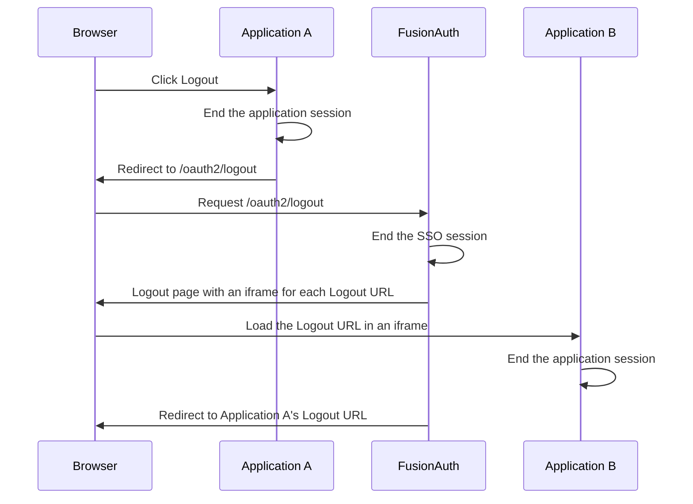

A user who logs in through FusionAuth holds several sessions at once. Logout has to end each one, and no single call ends them all. For the session types, see [How Sessions Work](/docs/authentication/sessions/how-sessions-work).

## What Each Logout Method Ends

| Method | Called from | SSO session | Refresh tokens | Other applications' **Logout URL** |
|---|---|---|---|---|
| [`/oauth2/logout`](/docs/apis/oauth/logout) | Browser | Ends | Unchanged | Loaded, unless **Logout behavior** is `Redirect only` |
| [`/api/logout`](/docs/apis/login/logout) | Browser or server, no API key | Unchanged | Revokes the one refresh token sent | Not loaded |
| [`/api/logout`](/docs/apis/login/logout) with **`global`** set to `true` | Browser or server, no API key | Ends | Revokes all of the user's refresh tokens | Not loaded |
| [`DELETE /api/jwt/refresh`](/docs/apis/jwt/revoke-refresh-tokens) | Server, with an API key | Ends when you revoke by user | Revokes by token, user, or Application | Not loaded |
| Admin UI <Breadcrumb>Users -> The User -> Sessions</Breadcrumb> | Admin UI | Ends when you delete the `single-sign-on` row | Revokes the rows you delete | Not loaded |
| [`/account/logout`](/docs/users/account-management) | Browser | Ends, then continues to `/oauth2/logout` | Revokes the account management session | Loaded, as with `/oauth2/logout` |
| [SAML Single Logout](/docs/authentication/act-as-an-idp/host-saml-idp#logout-request) | SAML service provider | Ends | Unchanged | With Single Logout enabled, sends SAML logout requests to the other service providers in the session |

No method ends an access token that a client already holds. The access token stays valid until the token expires.

No method ends an upstream [Identity Provider](/docs/authentication/identity-providers) session. A user who logs in with Google and then logs out of FusionAuth stays logged in to Google. For a workaround, see [Log Out of an Identity Provider](/docs/authentication/sessions/log-users-out#log-out-of-an-identity-provider).

## Front-Channel Logout

FusionAuth implements [OpenID Connect Front-Channel Logout](https://openid.net/specs/openid-connect-frontchannel-1_0.html) at `/oauth2/logout`. Your application ends the local session, then redirects the browser to `/oauth2/logout`. FusionAuth ends the SSO session and renders a logout page.

The logout page loads the **Logout URL** of every Application in the Tenant in a hidden iframe. FusionAuth loads every Application that has a **Logout URL**, including Applications the user never logged in to. FusionAuth appends the `iss` and `sid` parameters to each URL. Code at each **Logout URL** ends that application's session. When the iframes finish, FusionAuth redirects the browser to the `post_logout_redirect_uri`, or to the **Logout URL** of the Application that started the logout.

Each iframe loads a different site than the FusionAuth page. The browser sends the application's session cookie to the iframe only when the cookie allows cross-site use. Set the application's session cookie to `SameSite=None; Secure`, which requires HTTPS. Browsers that block third-party cookies can still drop the cookie. When the iframe can't read the session cookie, the code at the **Logout URL** can't find the session to end. For a design that doesn't depend on cookies in iframes, use [centralized sessions](/docs/authentication/sessions/centralized-sessions).

## Logout Behavior

Each Application's **Logout behavior** setting controls what happens when logout starts from that Application:

* `All applications` loads every **Logout URL** in the Tenant, then redirects. `All applications` is the default.
* `Redirect only` ends the SSO session and redirects, without loading the other applications' **Logout URL**. The other applications keep their sessions.

With either value, `/oauth2/logout` ends the SSO session. The next login redirect from any application shows the login form.

## Back-Channel Logout

FusionAuth doesn't implement [OpenID Connect Back-Channel Logout](https://openid.net/specs/openid-connect-backchannel-1_0.html). To end sessions from a server without a browser, use centralized sessions and revoke refresh tokens with the API. For the steps, see [View and Revoke Sessions](/docs/authentication/sessions/revoke-sessions).
