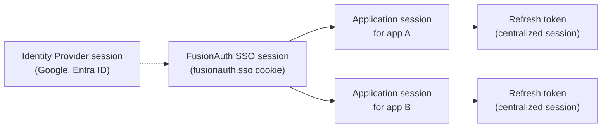

A [[session]] keeps a user logged in across requests without asking for credentials again. A user who logs in through FusionAuth usually has more than one session at the same time, and each session has a different owner and lifetime. Each session belongs to one user and one browser or device. A user who logs in from Chrome and Firefox on the same computer has two sets of sessions.

## Session Layers

The following diagram shows the sessions that can exist after a user logs in to an application through the [[hosted login pages]]:

The solid arrows show sessions that every SSO integration has. The dashed arrows show optional sessions: an upstream Identity Provider session exists only when the user logs in through one, and a refresh token exists only when the application requests one.

| Session | Owner | Created when | Ends when | Lifetime set by |
|---|---|---|---|---|
| Identity Provider session | The Identity Provider | The user logs in through an [Identity Provider](/docs/authentication/identity-providers) | The Identity Provider ends the session. FusionAuth logout doesn't end the session. | The Identity Provider |
| SSO session | FusionAuth | The user logs in through the hosted login pages with **Keep me signed in** checked | The user logs out through FusionAuth, an admin or API call revokes the session, or the session sits idle past the timeout | Tenant **Session timeout** |
| Application session | Your application | Your application finishes the token exchange after login | Your application ends the session | Your application |
| Centralized session | FusionAuth, checked by your application | Login with the `offline_access` scope, or a Login API call | An admin or API call revokes the refresh token, or the refresh token expires | Tenant or Application refresh token settings |

An access token can outlive the session that issued the token. A service that verifies access tokens keeps accepting a token until the token expires, even after you revoke the session.

The [self-service account management](/docs/users/account-management) pages keep a separate session. For the cookie behind each session, see [Login Page Cookies](/docs/authentication/sessions/cookies). For every setting, unit, and default, see [Session Settings](/docs/authentication/sessions/session-settings).

## The SSO Session

The [[SSO session]] lets a user log in once and then reach every other Application in the same [[Tenant]] without entering credentials again. When an application without a session redirects the user to FusionAuth, FusionAuth finds the SSO session and redirects back with an authorization code right away. The user sees a brief redirect.

FusionAuth creates the SSO session only when the user checks **Keep me signed in** on the login form. Without the SSO session, the user enters credentials at every login redirect. The SSO session is a refresh token with no Application, so the Admin UI lists the SSO session as `single-sign-on` on the user's <Breadcrumb>Sessions</Breadcrumb> tab. To create the SSO session at every login, see [Enable SSO Across Applications](/docs/authentication/sessions/enable-sso).

The SSO session uses an idle timeout. Each time FusionAuth uses the SSO session to log the user in to an application, the timeout starts over. Activity inside your applications doesn't reset the timeout, because your applications don't contact FusionAuth on each request. A user who stays in one application all day can find the SSO session expired when switching to a second application.

Every login through the SSO session follows the same rules as a login with credentials. When an Application requires registration, MFA, email verification, or consent, FusionAuth still asks for the missing step.

The SSO session differs from federated login. With an Identity Provider, the user logs in to FusionAuth with an outside account, such as Google. The FusionAuth SSO session then spans your applications. For more information, see [Identity Providers](/docs/concepts/identity-providers).

### How the SSO Session and Application Sessions Combine

The SSO session and each application session expire on their own schedules. When a request reaches an application, the result depends on both:

| Application session | SSO session | Result |
|---|---|---|
| Valid | Valid | The application serves the request. |
| Valid | Expired | The application serves the request. |
| Expired | Valid | The application redirects to FusionAuth. FusionAuth redirects back without a login form, and the application creates a new session. |
| Expired | Expired | The application redirects to FusionAuth, and the user logs in again. |

## Application Sessions

Your application keeps its own [[application session]] after login, in a server-side session store, a cookie, or a token held by the client. FusionAuth can't see or end an application session unless you connect the application session to FusionAuth. Choose one of the following approaches:

* An application-managed session. Your application controls the lifetime. FusionAuth ends the session only at logout, by loading the application's **Logout URL** in the browser. For more information, see [How Logout Works](/docs/authentication/sessions/how-logout-works).
* A [[centralized session]]. Your application stores the Id of a FusionAuth refresh token and checks the refresh token on each request. FusionAuth then controls the lifetime, and you can view and revoke the session from the Admin UI or the API. For the steps, see [Centralized Sessions](/docs/authentication/sessions/centralized-sessions).

The following table compares the approaches:

| Capability | Application-managed | Centralized |
|---|---|---|
| Log out of every application in the Tenant | Yes | Yes |
| Log out of some applications but not others | No | Yes |
| Revoke a session from the Admin UI or API | No | Yes |
| Set the session lifetime in FusionAuth | No | Yes |
| Works without a browser, or with the Login API | No | Yes |
| Sends a webhook when a session ends | No | Yes |
| Calls FusionAuth on every request | No | Yes |

You can combine the approaches. An application-managed session can revoke refresh tokens in the code at the **Logout URL**.

Most applications start with application-managed sessions. Choose centralized sessions when you need to end a session from a server, such as for a support tool, a suspicious login, or a device limit.
