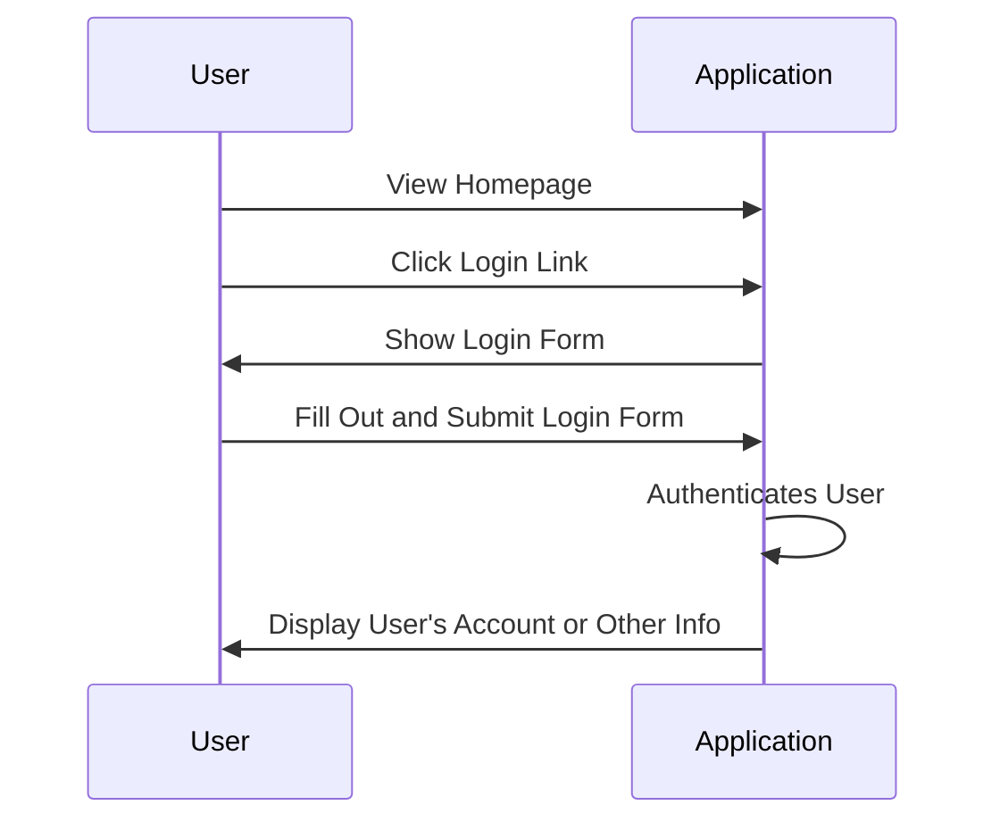
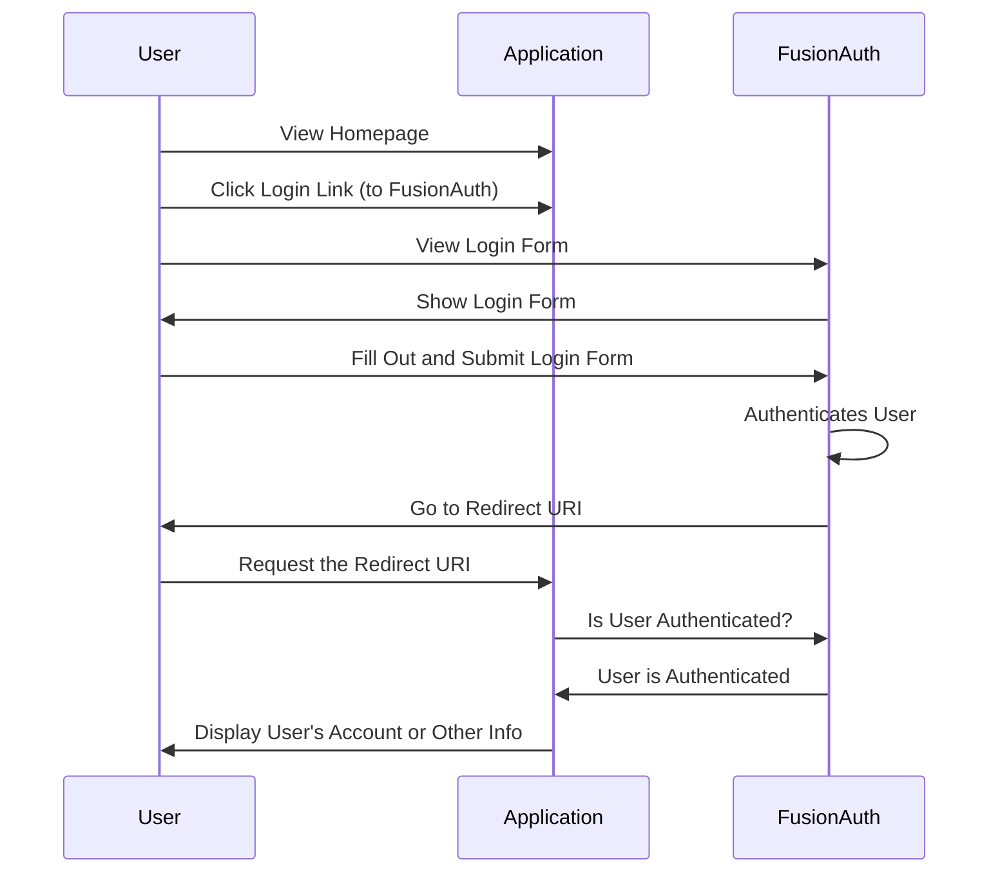

FusionAuth handles login for your applications. Your app sends users to FusionAuth to log in, and FusionAuth sends them back with tokens your app can trust.

Here's a typical application login flow before FusionAuth:

And here's the same application login flow after introducing FusionAuth:

Legacy identity technologies have complex hierarchy and cryptic terminology like realms, principals, subjects and distinguished names. In order to simplify something perceived to be complex, the best approach is to go back to the basics, to the atomic elements and throw everything else away.

When we built FusionAuth we took the back to basics approach. We identified two atomic elements of identify, Users and Applications. Everyone has Users, and Users need to be authenticated to Applications. For this reason FusionAuth is built upon four core elements:

* Users - someone that can log into things
* Applications - things that Users log into
* Registrations - the connection between a User and an Application they have access to
* Tenants - A way to logically isolate Applications, Users and Registrations

## Users

A user is uniquely identified in any particular tenant by an email address or username. [Learn more.](/docs/concepts/types/users)

## Applications

A FusionAuth Application represents an authenticated resource such as a web application, mobile application or any other application that requires authenticated users. A FusionAuth Application is defined by a name and a set of Roles. [Learn more.](/docs/concepts/types/applications)

## Registrations

A User can be registered to one or more FusionAuth Applications. A User Registration can define one to many Application Roles. [Learn more.](/docs/concepts/types/registrations)

## Tenants

Tenants are way to separate Users, Applications and Registrations into separate containers. Inside a Tenant, you can define any number of Users, Applications and Registrations. Across Tenants, you can define duplicate Applications, Users and Registrations.

For example, you might have two Tenants and inside both Tenants you might have an Application named `Web Based Payroll` and a User with the email address `john@piedpiper.com`. Each of these Users might have a Registration to the `Web Based Payroll` Application. And finally, each of these Users might have different passwords and data. [Learn more.](/docs/concepts/types/tenants)

## Learn More

<ChildCards />
