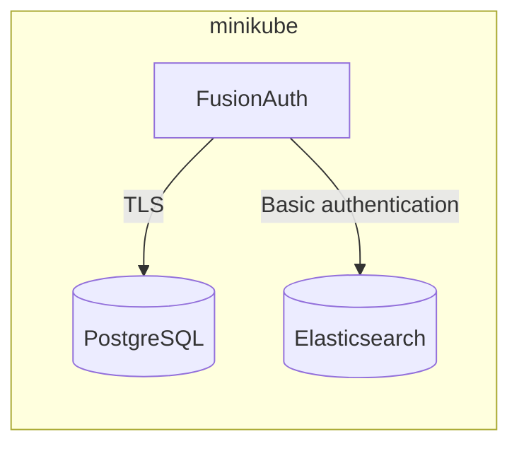

import Kubectl from 'src/content/docs/deploy/production/kubernetes/_kubectl.mdx';
import PodReady from 'src/content/docs/deploy/production/kubernetes/_pod-ready.mdx';

Having the capability to deploy applications in a local Kubernetes environment allows engineers to quickly develop, test, and demo without the operational overhead of a full-blown cluster. This is precisely what [minikube](https://minikube.sigs.k8s.io/docs) is designed for: it runs a single-node cluster on your machine.

This guide shows you how to install and start minikube, then deploy the PostgreSQL database and Elasticsearch service that FusionAuth needs. After that, you deploy FusionAuth itself with the [Deploy with k8s](/docs/deploy/production/kubernetes/fusionauth-deployment) guide.



## Requirements

Before you begin, you will need to have the following installed.

* [Docker Desktop](https://docs.docker.com/get-docker/) - The container environment you will use to run minikube.
* `helm` - Package manager used for installing and managing Kubernetes applications. The FusionAuth deployment guide uses a Helm chart to install FusionAuth. For more information, see [Installing Helm](https://helm.sh/docs/intro/install/).
<Kubectl />

## Install minikube

Navigate to [minikube start](https://minikube.sigs.k8s.io/docs/start/) and complete step one by selecting the options that apply to your local machine.

For example, on macOS, Homebrew is a popular **installer type**:

```shell title="Install minikube"
brew install minikube
```

### Start minikube

Since you will be deploying multiple applications, you will want to start minikube using some additional resource considerations.

<Aside type="caution">
Before proceeding, make sure Docker Desktop has sufficient resources allocated. These settings can be found in Docker Desktop by navigating to <Breadcrumb>Settings -> Resources</Breadcrumb>. You need to have at least as much memory allocated to Docker Desktop as you give to minikube below.
</Aside>

Start minikube by additionally specifying **cpus** and **memory**.

```shell title="Start minikube"
minikube start --cpus 4 --memory 5g
```

When the command finishes, it will configure `kubectl` to point to the minikube cluster. You can confirm this by checking the status:

```shell title="Get minikube status"
minikube status
```

```plaintext title="Output"
minikube
type: Control Plane
host: Running
kubelet: Running
apiserver: Running
kubeconfig: Configured
```

## Deploy PostgreSQL

This guide runs PostgreSQL from the official `postgres` image. When the database starts, it creates a self-signed certificate, so FusionAuth can connect to it over TLS with the settings in the deployment guide.

<Aside type="note">
The database keeps its data inside the container, so you lose the data when the pod restarts. This is fine for local testing. For anything else, use a managed database or a [PersistentVolume](https://kubernetes.io/docs/concepts/storage/persistent-volumes/).
</Aside>

First, store a password for the `postgres` superuser in a Secret. Choose your own password, and note it, because you will use it again when you deploy FusionAuth:

<ExtractedCode src="example-kubernetes/minikube/commands/create-postgres-secret.sh" lang="shell" title="Create a Secret for the PostgreSQL superuser" />

Then create a file named `postgres.yaml` with a Deployment that runs PostgreSQL and a Service that exposes it to the rest of the cluster:

<ExtractedCode src="example-kubernetes/minikube/postgres.yaml" lang="yaml" title="PostgreSQL configuration" />

Apply the file:

<ExtractedCode src="example-kubernetes/minikube/commands/apply-postgres.sh" lang="shell" title="Deploy PostgreSQL" />

## Deploy Elasticsearch

FusionAuth supports Elasticsearch `7.6.1` through `7.17.x`. This guide runs a single Elasticsearch `7.17` node with security enabled, so FusionAuth has to authenticate as the `elastic` user.

Store a password for the `elastic` user in a Secret, and note it as well:

<ExtractedCode src="example-kubernetes/minikube/commands/create-elasticsearch-secret.sh" lang="shell" title="Create a Secret for the elastic user" />

Then create a file named `elasticsearch.yaml`:

<ExtractedCode src="example-kubernetes/minikube/elasticsearch.yaml" lang="yaml" title="Elasticsearch configuration" />

Apply the file:

<ExtractedCode src="example-kubernetes/minikube/commands/apply-elasticsearch.sh" lang="shell" title="Deploy Elasticsearch" />

## Verify the Deployments

It may take a minute or two for the pods to reach a `READY` state. Check them with `kubectl`:

<ExtractedCode src="example-kubernetes/minikube/commands/get-pods.sh" lang="shell" title="Get pods" />

```plaintext title="Output"
NAME                             READY   STATUS    RESTARTS   AGE   IP           NODE       NOMINATED NODE   READINESS GATES
elasticsearch-5ccc6b7c77-vm76w   1/1     Running   0          38s   10.244.0.6   minikube   <none>           <none>
postgres-78cf4d89f8-ppkdj        1/1     Running   0          38s   10.244.0.5   minikube   <none>           <none>
```

<PodReady />

Each Deployment has a [Service](https://kubernetes.io/docs/concepts/services-networking/service/) that exposes it to the rest of the cluster:

<ExtractedCode src="example-kubernetes/minikube/commands/get-services.sh" lang="shell" title="Get services" />

```plaintext title="Output"
NAME            TYPE        CLUSTER-IP     EXTERNAL-IP   PORT(S)    AGE
elasticsearch   ClusterIP   10.96.9.215    <none>        9200/TCP   38s
kubernetes      ClusterIP   10.96.0.1      <none>        443/TCP    58s
postgres        ClusterIP   10.96.179.62   <none>        5432/TCP   38s
```

The `kubernetes` Service directs traffic to the Kubernetes API server.

### Kubernetes DNS

Kubernetes assigns each Service a DNS name that other pods in the cluster can use:

* `postgres.default.svc.cluster.local`
* `elasticsearch.default.svc.cluster.local`

For more information, see the Kubernetes documentation for [DNS for Services and Pods](https://kubernetes.io/docs/concepts/services-networking/dns-pod-service/).

## Next Steps

You now are running all the necessary infrastructure to deploy FusionAuth to minikube. Next up, [Deploy FusionAuth in Kubernetes](/docs/deploy/production/kubernetes/fusionauth-deployment). When you configure the chart in that guide, use these values:

* **database.host**: `postgres.default.svc.cluster.local`
* **database.rootUser.username**: `postgres`, with the PostgreSQL password you chose above as the superuser password
* **search.host**: `elasticsearch.default.svc.cluster.local`
* **search.protocol**: `http`, because this Elasticsearch node doesn't use a certificate
* The search username `elastic`, with the Elasticsearch password you chose above
