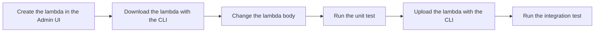

In this guide, you create a JWT populate lambda in a local FusionAuth instance, then change the lambda once with the FusionAuth CLI. You test the change in two ways:

* Before you upload the change, a unit test runs the lambda in a Node.js harness, without FusionAuth.
* After you upload the change, an integration test logs in to FusionAuth and checks the token FusionAuth issues.



For the objects and methods available in a lambda, see [Lambdas](/docs/lambdas).

## Prerequisites

To follow this guide, you need:

* [Node.js](https://nodejs.org/en/download) `20` or later.
* [Docker](https://www.docker.com/get-started/).

## Start FusionAuth

Create a folder for the project, and open a terminal in the folder. Download the FusionAuth Docker Compose file:

```shell-session
curl -o docker-compose.yml https://fusionauth.io/docs/docker-compose.yml
```

Create a `kickstart` folder in the project folder. Save the following file in the `kickstart` folder as `kickstart.json`:

<ExtractedCode src="example-testing-lambdas/kickstart/kickstart.json" lang="json" title="A Kickstart file that configures FusionAuth for this guide." />

FusionAuth reads the Kickstart file on first start. The Kickstart file creates the following:

* An application named `Example app` with the roles `admin`, `editor`, and `viewer`.
* An API key with the value `lambda_testing_key`.
* A user with the email `richard@example.com`, the password `password`, and the `editor` role.
* An administrator with the email `admin@example.com` and the password `password`.

Start FusionAuth:

```shell-session
docker compose up -d
```

FusionAuth runs at [http://localhost:9011](http://localhost:9011). For more about the Docker Compose file, see [Install FusionAuth](/docs/get-started/install).

<Aside type="caution">
  The Kickstart file contains passwords and an unrestricted API key. Use these values only on a local instance, and never commit real secrets to version control.
</Aside>

## Create the Lambda

The following lambda adds a `message` claim and a `permissions` claim to the access token. The permissions depend on the user's roles for the application:

<ExtractedCode src="example-testing-lambdas/complete-application/role-permissions.js" lang="javascript" title="A lambda that adds permissions based on roles." />

To create the lambda:

1. Log in to the [Admin UI](http://localhost:9011/admin) as `admin@example.com`.
1. Navigate to <Breadcrumb>Customizations -> Lambdas</Breadcrumb>.
1. Click <IconButton icon="add" />.
1. Set **Id** to `f3b3b547-7754-452d-8729-21b50d111505`.
1. Set **Name** to `[ATest]`. The brackets sort the lambda to the top of the list.
1. Set **Type** to `JWT Populate`.
1. Replace the body with the lambda code.
1. Click <IconButton icon="save" />.

<Screenshot id="lambda-populate" url="/admin/lambda/add" alt="The Add Lambda form with the JWT populate lambda filled in." />

To assign the lambda to the application:

1. Navigate to <Breadcrumb>Applications</Breadcrumb> and click <IconButton icon="edit" /> on `Example app`.
1. Select the <Breadcrumb>JWT</Breadcrumb> tab.
1. Under <Breadcrumb>Lambda settings</Breadcrumb>, set **Access Token populate lambda** to `[ATest]`.
1. Click <IconButton icon="save" />.

<Screenshot id="lambda-edit-application" url="/admin/application/edit?applicationId=e9fdb985-9173-4e01-9d73-ac2d60d1dc8e&tenantId=30663132-6464-6665-3032-326466613934#jwt" height={1000} alt="The application JWT tab with the access token populate lambda selected.">
  <Highlight selector="#application_lambdaConfiguration_accessTokenPopulateId-form-row" />
</Screenshot>

To create and assign a lambda from a script instead, use the [Lambda API](/docs/apis/lambdas) and the [Application API](/docs/apis/applications).

## Confirm the Lambda Runs

Log in as `richard@example.com` with the [Login API](/docs/apis/login):

```shell-session
curl -X POST http://localhost:9011/api/login \
  -H "Authorization: lambda_testing_key" \
  -H "Content-Type: application/json" \
  -d '{"applicationId": "e9fdb985-9173-4e01-9d73-ac2d60d1dc8e", "loginId": "richard@example.com", "password": "password"}'
```

Copy the **`token`** value from the response, and paste the value into **Token** in the [FusionAuth JWT Decoder](/dev-tools/jwt-decoder). The decoded payload contains the following claims:

```json
"roles": ["editor"],
"message": "Hello World!",
"permissions": ["read", "write"]
```

## Download the Lambda With the CLI

The [FusionAuth CLI](https://github.com/FusionAuth/fusionauth-node-cli) downloads and uploads lambdas, so you can keep lambda code in version control. The CLI can retrieve, update, and delete a lambda. To create a lambda or assign a lambda to an application, use the Admin UI, the [Lambda API](/docs/apis/lambdas), or a [client library](/docs/sdks).

The CLI needs an API key. The Kickstart file created `lambda_testing_key`, which has access to every endpoint. In production, create a key limited to the endpoints you use, such as `/api/lambda`. See [Managing API Keys](/docs/apis/authentication#managing-api-keys).

Create a Node.js project in the project folder, and install the CLI:

```shell-session
npm init -y
npm install --save-dev @fusionauth/cli@^1.9.0
```

Download the lambda:

```shell-session
npx fusionauth lambda:retrieve f3b3b547-7754-452d-8729-21b50d111505 --key lambda_testing_key
```

The CLI saves the lambda to `lambdas/f3b3b547-7754-452d-8729-21b50d111505.json`. The file contains the Lambda object from the Lambda API, including the **`body`** and **`type`** fields. To skip `--key` on each command, set the `FUSIONAUTH_API_KEY` environment variable. The CLI connects to `http://localhost:9011` unless you pass `--host` or set `FUSIONAUTH_HOST`.

## Change the Lambda

In the downloaded file, find `Hello World!` in the **`body`** value and change the text to `Goodbye World!`. Don't upload the change yet.

## Test the Change With a Unit Test

A unit test runs the lambda without FusionAuth, so the test is fast and needs no running instance. The [`example-lambdas` folder](https://github.com/FusionAuth/fusionauth-site/tree/main/astro/extractedcode/example-lambdas) of the `fusionauth-site` repository contains a harness that runs a lambda the way FusionAuth does. The harness has no dependencies. The harness provides only the globals FusionAuth provides, such as `fetch`, `Headers`, and `console`. The harness passes arguments through JSON, discards changes to read-only arguments, and applies the FusionAuth rules for reserved JWT claims. A lambda that passes a harness test runs the same way in FusionAuth, apart from engine differences such as locale data.

Download the harness into a `harness` folder:

```shell-session
curl -fs --create-dirs -o "harness/#1" "https://raw.githubusercontent.com/FusionAuth/fusionauth-site/main/astro/extractedcode/example-lambdas/harness/{index.js,lambda-types.js,sandbox.js,package.json}"
```

Create `lambda.test.mjs` with the following code:

<ExtractedCode src="example-testing-lambdas/complete-application/lambda.test.mjs" lang="javascript" title="A harness test of the lambda the CLI downloaded." />

The test reads the **`body`** and **`type`** fields from the downloaded file and passes them to `loadLambda()`. Each test calls `invoke()` with the lambda arguments by name, then checks the `jwt` that FusionAuth would keep. The test needs only the fields the lambda reads, so the `user` and `registration` objects stay small. The `.mjs` extension and the `package.json` file in the `harness` folder let the test use ES modules in a project that uses CommonJS.

Run the test:

```shell-session
node --test lambda.test.mjs
```

Node.js reports four passing tests. If you skipped the change to `Goodbye World!`, the first test fails. Run the unit test after every change, such as in a CI job, before you upload the lambda.

<Aside type="caution">
  The harness runs lambdas with the Node.js `vm` module, which isn't a security boundary. A malicious lambda can escape the harness and reach your file system and network. Run only lambdas you trust, such as lambdas from your own FusionAuth instance and source control.
</Aside>

## Upload the Lambda

Upload the changed lambda:

```shell-session
npx fusionauth lambda:update f3b3b547-7754-452d-8729-21b50d111505 --key lambda_testing_key
```

To confirm the upload, navigate to <Breadcrumb>Customizations -> Lambdas</Breadcrumb> in the Admin UI and open `[ATest]`. The body now sets the message to `Goodbye World!`.

## Test the Upload With an Integration Test

An integration test runs the lambda in FusionAuth. The test logs in and checks the token FusionAuth issues. An integration test catches problems that a unit test can't, such as an unassigned lambda or a missing license.

The integration test uses the [TypeScript client library](/docs/sdks/typescript) to call FusionAuth, [`tape`](https://github.com/ljharb/tape) as the test runner, and [`jsonwebtoken`](https://www.npmjs.com/package/jsonwebtoken) to decode the token. Install the packages:

```shell-session
npm install --save-dev @fusionauth/typescript-client@^1.70.0 tape@^5.6.6 jsonwebtoken@^9.0.1
```

Create `userLogin.js` with the following code:

<ExtractedCode src="example-testing-lambdas/complete-application/userLogin.js" lang="javascript" title="A helper function that logs in and returns the token claims." />

`login()` calls the Login API and returns the claims of the token in the response. When the login fails, the client library rejects the promise with the response, so the test fails with the error from FusionAuth.

Create `test_1.js` with the following code:

<ExtractedCode src="example-testing-lambdas/complete-application/test_1.js" lang="javascript" title="An integration test that checks the claims from the lambda." />

The test logs in as `richard@example.com`, the user the Kickstart file created. The test checks that the token contains the message from the uploaded lambda and the permissions for the `editor` role.

Run the test:

```shell-session
node test_1.js
```

The output looks like the following:

```plaintext
TAP version 13
# the access token has the claims from the uploaded lambda
ok 1 should be strictly equal
ok 2 should be deeply equivalent

1..2
# tests 2
# pass  2

# ok
```

FusionAuth can run the previous lambda body for a few seconds after an upload. If the test fails right after `lambda:update`, run the test again.

## Test a Lambda That Calls an API

A lambda that calls an API with `fetch()` needs [Lambda HTTP Connect](/docs/lambdas/lambda-remote-api-calls), which requires the Essentials or Enterprise plan. A unit test doesn't need a plan, because the harness answers `fetch()` calls with mock responses. A request with no matching mock throws an error, so the test can't reach the network.

The following test checks the lambda from [Call an API from a Lambda](/docs/lambdas/lambda-remote-api-calls#example-lambda). The test mocks the billing API, supplies the lambda secret, and checks the fallback when the API fails:

<ExtractedCode src="example-lambdas/lambdas/jwt-populate/billing-tier.test.js" lang="javascript" title="A harness test for a JWT populate lambda that calls an API." />

`invoke()` also returns `logs`, the console output, and `requests`, the `fetch()` calls the lambda made. `requests` lists only the headers the lambda set, not the default headers FusionAuth adds. For the full list of harness options, see the [harness README](https://github.com/FusionAuth/fusionauth-site/tree/main/astro/extractedcode/example-lambdas#readme).

A mock can't confirm that the real API accepts the request. After the unit tests pass, upload the lambda and run an integration test against a licensed FusionAuth instance.
