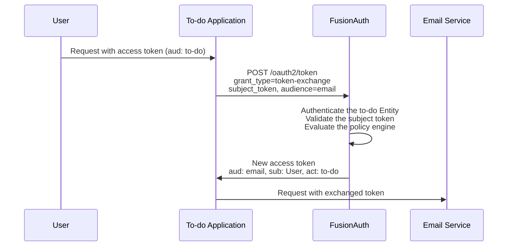

<PlanBlurb plan="enterprise" />

<AvailableSince since="1.70.0" />

Token exchange lets a service trade a token it received for a new access token that targets a different service. FusionAuth implements the token exchange grant defined in [RFC 8693](https://datatracker.ietf.org/doc/html/rfc8693) at the [Token endpoint](/docs/apis/oauth/token#token-exchange-grant-request).

The issued token keeps the original subject in the `sub` claim and identifies the service that performed the exchange in the `act` claim. A downstream service can use these claims to determine both the User a request is for and the service making the request.

To set up an exchange step by step, see [Delegate Access With Token Exchange](/docs/lifecycle/authenticate-users/oauth/token-exchange-delegation).

## When to Use Token Exchange

Consider a to-do application that sends reminder emails through a separate email service. A User logs in to the to-do application and receives an access token with an audience of the to-do application. To send a reminder, the to-do application must call the email service on behalf of that User.

Without token exchange, the to-do application has two options, and both have drawbacks:

* Forward the User's access token to the email service. The token's audience names the to-do application, so the email service must accept tokens intended for another service. Any service that receives the token can replay it against every other service that makes the same compromise.
* Call the email service with its own client credentials. The email service can no longer tell which User the request is for, so it can't apply per-User authorization or produce a useful audit trail.

With token exchange, the to-do application sends the User's access token to FusionAuth and requests a new token for the email service. FusionAuth checks that the to-do application is allowed to make the exchange, then issues a token with the email service as its audience, the User as its subject, and the to-do application recorded as the actor:



Token exchange also accepts JWTs from other issuers. A service that receives a token from a trusted external Identity Provider can exchange it for a FusionAuth access token, so downstream services only need to validate tokens from FusionAuth.

## Delegation and Impersonation

RFC 8693 describes two kinds of exchange. With impersonation, the issued token is indistinguishable from a token issued directly to the subject. With delegation, the issued token identifies the actor separately from the subject.

FusionAuth supports delegation. Every token FusionAuth issues through token exchange contains an `act` claim that identifies the actor.

## How FusionAuth Processes an Exchange

FusionAuth handles a token exchange request in the following order. If any step fails, FusionAuth rejects the request and records the failure in the [Token Exchange audit log](#auditing).

1. Authenticate the exchanger. The exchanger is the Entity whose client credentials authenticate the request. The Entity must have **Act as token exchange client** enabled, and its Tenant must have token exchange enabled.
1. Validate the subject token, the token being exchanged. See [Subject Tokens](#subject-tokens).
1. Check the depth of the [actor chain](#the-actor-chain) in the subject token against the Tenant's **Max act claim depth**.
1. Evaluate the Tenant's [policy engine](#policy-engines), which decides whether to allow the exchange and which audiences and scopes to grant.
1. Build the new token. The token contains the subject token's `sub`, the granted audiences in `aud`, the granted scopes in `scope`, a new `act` claim, and the exchanger's client Id in `client_id`.
1. Run the Tenant's [Token Exchange Populate lambda](/docs/extend/code/lambdas/token-exchange-populate), if one is configured.
1. Sign the token. FusionAuth uses the access token signing key from the exchanger's Entity Type when the Entity Type has JWT configuration enabled, and the Tenant's access token signing key otherwise.
1. Write an audit log entry and send the `token.exchange` event to any configured webhooks. The `token.exchange` event is transactional, so if a webhook fails to accept it, FusionAuth rejects the exchange.

The issued token also carries the following claims from the subject token, when present, so that it stays tied to the original authentication: `amr`, `applicationId`, `auth_time`, `authenticationType`, and `sid`. FusionAuth doesn't copy any other claims from the subject token. A populate lambda can copy additional claims.

## Subject Tokens

The `subject_token_type` parameter tells FusionAuth how to validate the subject token. FusionAuth supports two subject token types:

| `subject_token_type` | Accepted tokens | Validation |
|---|---|---|
| `urn:ietf:params:oauth:token-type:access_token` | Access tokens issued by FusionAuth for the exchanger's Tenant. | FusionAuth verifies the signature with its own keys and checks that the issuer matches the Tenant's issuer. The token must be a User access token from the Authorization Code, Implicit, Password, Device Authorization, or Token Exchange grant. |
| `urn:ietf:params:oauth:token-type:jwt` | JWTs from an issuer listed in the Tenant's **Allowed issuers**. | FusionAuth finds the issuer's signing keys through OpenID Connect discovery, then verifies the signature. The JWT must contain `exp`, `iss`, and `sub` claims and a `kid` header. |

The `jwt` type always uses the external issuer path, even for a JWT that FusionAuth issued. To accept a FusionAuth access token with the `jwt` type, add the FusionAuth issuer to **Allowed issuers**.

Each entry in **Allowed issuers** must be an absolute `https` URL or an `http://localhost` URL. Outside of production mode, the entry `*` accepts any issuer. FusionAuth rejects `*` when it runs in production mode.

FusionAuth rejects a subject token of either type that:

* has a blank `sub` claim
* contains a `cnf` claim, such as a token bound to a [DPoP](/docs/lifecycle/authenticate-users/oauth/dpop) key
* contains a `may_act` claim
* contains an `act` claim that isn't a JSON object

FusionAuth doesn't support the `actor_token` and `actor_token_type` parameters. The exchanger's client credentials identify the actor.

## The Actor Chain

The `act` claim, defined in [RFC 8693 Section 4.1](https://datatracker.ietf.org/doc/html/rfc8693#section-4.1), identifies the actor. FusionAuth sets two members in each `act` object:

* `sub`: the client Id of the exchanger Entity.
* `sub_profile`: `fusionauth:` followed by the name of the exchanger's Entity Type, such as `fusionauth:API Service`.

When the subject token already contains an `act` claim, FusionAuth nests it inside the new `act` claim. The top-level `act` always identifies the most recent actor, and each nested `act` identifies the actor before it.

For example, the to-do application exchanges a User's token to call the email service. The email service then exchanges the token it received to call a template service. The token that reaches the template service contains the following claims:

```json title="Claims in a token exchanged twice"
{
  "sub": "c0a6ae6c-6d38-4bb5-a7c2-4d2b4e3a1f2d",
  "aud": ["template-service"],
  "act": {
    "sub": "email-service",
    "sub_profile": "fusionauth:API Service",
    "act": {
      "sub": "todo-app",
      "sub_profile": "fusionauth:API Service"
    }
  }
}
```

The email service is the current actor. The to-do application acted before it.

RFC 8693 recommends that a resource server base access decisions on the subject and the top-level actor only, and treat nested actors as informational. Nested actors are useful for auditing.

### Chain Depth

The Tenant's **Max act claim depth** setting limits how many actors a chain can contain. The default is `2`, and the maximum is `10`. FusionAuth rejects an exchange when the subject token's chain already contains that many actors, because the new token would exceed the limit. With the default value, a User's token can be exchanged twice.

## Policy Engines

The policy engine decides whether FusionAuth allows an exchange, and which audiences, scopes, and lifetime the issued token receives. Each Tenant uses one of two policy engines:

| | Entity | Lambda |
|---|---|---|
| Decision based on | Entity Grants between the exchanger and each audience | Custom JavaScript in a Token Exchange Policy lambda |
| `audience` parameter | Required. Each value must be the client Id of an Entity in the Tenant. | Optional, but the request must include `audience` or `resource`. |
| `resource` parameter | Rejected | Supported |
| `scope` parameter | Ignored | Passed to the lambda |
| Issued scopes | All scopes from the subject token | The scopes the lambda grants |

### Entity Policy Engine

The Entity policy engine uses [Entity Grants](/docs/get-started/core-concepts/types/entity-management) to authorize exchanges. The exchanger Entity must have a Grant on every Entity named in the `audience` parameter. FusionAuth only checks that the Grant exists, and ignores the permissions on it.

The issued token contains every scope from the subject token. FusionAuth ignores the `scope` request parameter, so the Entity engine can't narrow scopes. To narrow scopes, use a populate lambda or the Lambda policy engine.

The issued token's lifetime is the exchanger's Entity Type JWT duration when the Entity Type has JWT configuration enabled, and the Tenant's JWT duration otherwise.

### Lambda Policy Engine

The Lambda policy engine runs a [Token Exchange Policy lambda](/docs/extend/code/lambdas/token-exchange-policy) for each request. The lambda receives the exchanger's client Id, the requested audiences and resources, the requested scopes, and the subject token's claims. It returns a decision that allows or denies the exchange.

When the lambda allows an exchange, FusionAuth limits what the issued token receives:

* FusionAuth drops granted audiences that the request didn't include in `audience` or `resource`. If no granted audiences remain, FusionAuth denies the exchange.
* When the subject token has a `scope` claim, FusionAuth drops granted scopes that the subject token doesn't contain. If the request included `scope` and no granted scopes remain, FusionAuth denies the exchange.
* The issued token's lifetime is the lifetime the lambda grants or the lifetime the Entity engine would use, whichever is shorter.

FusionAuth writes dropped audiences and scopes to the [Event Log](/docs/operate/troubleshooting#event-log).

## Customizing the Issued Token

A [Token Exchange Populate lambda](/docs/extend/code/lambdas/token-exchange-populate) runs after the policy engine allows an exchange and before FusionAuth signs the token. The lambda can add claims and narrow the token's audience, scope, and expiration. It can't widen what the policy engine granted, and it can't change the claims that identify the subject, the actor, or the original authentication.

## Auditing

FusionAuth records every token exchange attempt, successful or not, in the Token Exchange audit log. Each entry includes the exchanger, the subject token's `jti`, `sub`, and `iss`, the requested and granted values, the policy decision, the outcome, and the actor chain of the issued token.

Find these entries in the Admin UI under <Breadcrumb>System -> Token Exchange Log</Breadcrumb>. Users need the `admin` or `token_exchange_log_viewer` role to view them. To search entries, use the [Search the Token Exchange Audit Log](/docs/apis/system/search-the-token-exchange-audit-log) API. To trace the full chain of exchanges behind an issued token, use the [Retrieve a Token Exchange Chain](/docs/apis/system/retrieve-a-token-exchange-chain) API.

FusionAuth deletes entries after 7 days by default. To change the retention period, navigate to <Breadcrumb>Settings -> System -> Advanced</Breadcrumb> and update **Retain token exchange logs**.

To get more detail about a failed exchange, enable **Enable debug logging** in the Tenant's token exchange settings. FusionAuth then writes the reason for each failure to the [Event Log](/docs/operate/troubleshooting#event-log).

FusionAuth also sends two webhook events for each attempt:

* [`token.exchange`](/docs/extend/events-and-webhooks/events/token/token-exchange): a transactional event sent before FusionAuth returns a token. If a webhook fails to accept this event, FusionAuth rejects the exchange.
* [`token.exchange.complete`](/docs/extend/events-and-webhooks/events/token/token-exchange-complete): a non-transactional event sent after FusionAuth records the attempt.

## Limitations

FusionAuth's implementation of RFC 8693 has the following limitations:

* FusionAuth supports delegation but not impersonation.
* FusionAuth only issues access tokens. The `requested_token_type` parameter, if present, must be `urn:ietf:params:oauth:token-type:access_token`.
* FusionAuth doesn't support the `actor_token` and `actor_token_type` parameters.
* The exchanger must be an Entity. Applications can't act as exchangers.
