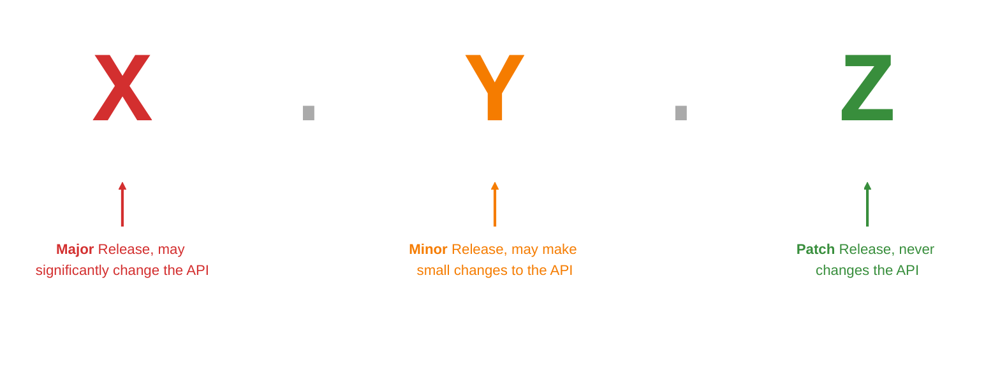

import ReleaseNotification from 'src/content/docs/_shared/_release-notification.mdx';

This section describes how to update any instance of FusionAuth to the latest version.

<ChildCards />

## Stay Informed

<ReleaseNotification />

## FusionAuth Versioning

FusionAuth releases come in three flavors: major, minor, and patch.

You can tell what a release is from the rightmost non-zero number in the version: `<major>.<minor>.<patch>`.

For example:

* `1.0.0`: major release, may significantly change the API
* `1.63.0`: minor release, may make small changes to the API
* `1.45.1`: patch release, never changes the API

The FusionAuth team provides detailed information about every change in every version, including tying the change back to a GitHub issue. To understand how a version update affects your systems, read the [release notes](/docs/release-notes).

### Client Library Versioning

FusionAuth represents releases with a version number: `<major>.<minor>.<patch>`. Major releases can add, change, or remove functionality from the API, minor releases can add to the API, but patch releases never change the API. Client library version numbers show you which API version a client library was built for.

We recommend using a client library with the same `major` and `minor` numbers as your FusionAuth instance version. This ensures that your client library supports the same APIs as your FusionAuth instance.

If you don't keep your client library in sync with your FusionAuth version:

* you won't be able to access new API endpoints
* you won't benefit from client library improvements (e.g. exponential backoff, improved HTTP connections, etc)
* you could experience subtle bugs when existing API endpoints change behavior (e.g. changed argument order in an untyped language)

Patch releases don't always exist for client libraries since many bugfixes and small changes don't impact client libraries. FusionAuth only creates patch releases for client libraries when we fix an issue in the library, so always update to the latest `patch` release for your `major` and `minor` version. Patch releases may also update dependencies, language engines, and operating systems, as we follow the deprecation and sunsetting policies of each platform.

Consider a user whose FusionAuth instance runs version `1.61.1`. They should:

* use Java client library version [`1.61.2`](https://github.com/FusionAuth/fusionauth-java-client/releases/tag/1.61.2), the latest patch release for `1.61.x`
* use TypeScript client library version [`1.61.0`](https://www.npmjs.com/package/@fusionauth/typescript-client/v/1.61.0), the latest patch release for `1.61.x`

This theoretical user also ought to update their FusionAuth instance to `1.61.2`, the latest patch for the `major` and `minor` instance version.

## Update a FusionAuth Cloud Deployment

To update your FusionAuth Cloud deployment, see the [Update a Deployment Guide](/docs/cloud/update-a-deployment).

## Update a Client Library

Older FusionAuth client libraries should work properly with newer FusionAuth versions upon updating. However, once you use new features on that instance, FusionAuth might return enumeration values that older clients do not understand. This can cause client operations to fail.

Note that newer FusionAuth client libraries *might not* be compatible with older FusionAuth versions.

The [release notes](/docs/release-notes) provide more information about API changes between versions.

If you are using an OIDC-compatible library in your application to log your users in, it is unlikely that this integration would require modification, but test it in a non-production environment to make sure.

## Update FAQs

You can skip minor versions, as long as you read the release notes for every version you skip and test the update in a non-production environment. FusionAuth applies every database migration needed to reach the new version. See [Decide How Far to Jump](/docs/update/prod-instance#decide-how-far-to-jump).

We recommend staying within the last three minor versions, but we will not force an update. In addition, we typically don't backport bug fixes. If you run into an issue with a bug, you'll need to update to get the fix. We recommend you set up a regular cadence of reviewing and updating FusionAuth that fits your business needs, the same as you would with a framework or library your application depends on.

We publish release notes for every release. You can find them here: [Release Notes](/docs/release-notes). There are a variety of ways to be [notified of releases](/docs/update#stay-informed), including an email list and RSS feed.

At this time, FusionAuth does not support zero-downtime updates when there is a database change. While there are a variety of options that can minimize downtime, updates will cause downtime whenever a schema change is required. Please [review and upvote this issue](https://github.com/FusionAuth/fusionauth-issues/issues/1240) if zero-downtime updates are important to you.

This depends on the amount of data in your system, the speed of your database, the schema changes in the release, and your [update strategy](/docs/update/prod-instance#choose-an-update-strategy). Multi-node clusters can minimize downtime. For example, multi-node clusters in FusionAuth Cloud experience user-facing downtime on the order of seconds to minutes during updates. Testing an update in a non-production environment is the surest way to understand the amount of downtime. See [Downtime and Locking](/docs/update/database-migrations#downtime-and-locking).

The runtime mode, `development` or `production`, controls whether FusionAuth offers Maintenance Mode. Together with silent mode, it decides how database migrations are applied during an update. See [When FusionAuth Applies Migrations](/docs/update/database-migrations#when-fusionauth-applies-migrations).

Maintenance Mode is an interactive setup page, available only in the `development` runtime mode, that configures the database and search engine and applies database migrations. Never use it in production. See [Maintenance Mode](/docs/update/database-migrations#maintenance-mode).

[Silent Mode](/docs/get-started/download-and-install/reference/silent-mode) makes FusionAuth apply database migrations automatically on startup, which suits automated deployments. As of version `1.19.0`, it works in both runtime modes. If a migration fails, FusionAuth displays an error message on the login page. See [Database Migrations](/docs/update/database-migrations).

