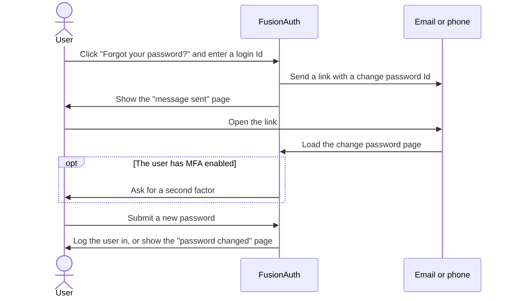

When users forget a password, FusionAuth sends them a link to choose a new one. This forgot password workflow is the account recovery process for password users. The workflow runs on the [[hosted login pages]], or in your own pages through the [Forgot Password API](/docs/apis/users/forgot-password) and the [Change Password API](/docs/apis/users/change-password).

## The Forgot Password Workflow

The workflow has two steps. First, the user asks for a reset, and FusionAuth sends a message containing a change password Id. Then the user opens the link in the message and sets a new password:

The hosted login pages use four [theme templates](/docs/theme/advanced-themes#templates) for the workflow:

* `passwordForgot` at `/password/forgot` collects the login Id.
* `passwordSent` at `/password/sent` confirms that FusionAuth sent the message.
* `passwordChange` at `/password/change/{changePasswordId}` collects the new password.
* `passwordComplete` at `/password/complete` confirms the change.

When the user starts the workflow from an OAuth login, FusionAuth completes the login after the password change. The user then returns to your application without logging in again. Otherwise, FusionAuth shows the `passwordComplete` page.

## Email and Text Message Delivery

<AvailableSince since="1.59.0">Recovery by text message.</AvailableSince>

FusionAuth chooses the delivery method from the identity the login Id matches:

* A login Id that matches an email address or username sends an email to the user's email address.
* A login Id that matches a phone number sends a text message to that number, through the Tenant's messenger.

Both messages contain the same kind of link. FusionAuth doesn't send a code for the user to type in.

The [[Tenant]] sets one template for each delivery method in the **Forgot password** template settings. An [[Application]] can override either template, for example to brand the message for that application. See [Application-Specific Email Templates](/docs/email/configuring-application-specific-email-templates). For the template variables, see the [email template reference](/docs/email/template-reference#forgot-password) and the [message template reference](/docs/messengers/template-reference#forgot-password).

The Tenant templates also turn the workflow on. Without a Tenant template for a delivery method, the workflow is off for that delivery method, even when an Application sets an override. See [Turn Off Forgot Password](/docs/users/account-recovery/turn-off-forgot-password).

## The Change Password Id

The change password Id in the link identifies the user. The Id follows these rules:

* The Id expires 10 minutes after FusionAuth creates the Id. To change the lifetime, set **Change password** in the Tenant's [external identifier durations](/docs/concepts/types/tenants#external-identifier-durations-form-fields).
* The Id works once. A successful password change deletes the Id.
* A new forgot password request deletes the user's earlier Ids, so only the newest link works.

Anyone who holds a valid Id can set the user's password. Treat the Id like a password.

## Recovery and MFA

A user with [multi-factor authentication](/docs/authentication/multi-factor-authentication) enabled must pass an MFA challenge before FusionAuth accepts a new password. A link in an email or text message proves access to that inbox or phone, and the second factor proves the rest. Without this check, an attacker who controls the user's inbox could take over an account that MFA protects.

On the hosted login pages, FusionAuth asks for the second factor before the change password form. A browser that the user already trusts from an earlier MFA login skips the challenge. After the password change, the user doesn't see a second MFA prompt during login.

With the API, the Change Password API returns the `[TrustTokenRequired]` error for these users. Your code must first complete an MFA challenge to get a trust token. See [Build a Password Reset Flow With the API](/docs/users/account-recovery/api#handle-users-with-mfa).

MFA [recovery codes](/docs/authentication/multi-factor-authentication#recovery-codes) cover a different problem: a user who knows the password but lost the second factor.

## What Changes After a Reset

A successful password change has these effects:

* FusionAuth revokes the user's refresh tokens. To keep refresh tokens, turn off **On password change** in the Tenant's [refresh token settings](/docs/concepts/types/tenants#refresh-token-settings).
* FusionAuth clears a required password change on the user.
* FusionAuth can unlock an account that too many failed logins locked. To allow the unlock, enable **Cancel action on password reset** in the Tenant's [failed authentication settings](/docs/security/account-protection/account-lockout).
* FusionAuth can mark the email address or phone number that received the link as verified, depending on the Tenant's identity verification settings.

The new password must meet the Tenant's [password rules](/docs/concepts/types/tenants#password-settings). When [breached password detection](/docs/security/account-protection/breached-password-detection) is on, FusionAuth also rejects a password that appears in a known breach.

## Notifications and Events

<PlanBlurb plan="enterprise" />

FusionAuth can tell the user that the password changed with the **Password reset success** email or message template. FusionAuth also sends these webhook events during the workflow:

* [`user.password.reset.start`](/docs/events/reference/user/password/user-password-reset-start) when a user starts the workflow.
* [`user.password.reset.send`](/docs/events/reference/user/password/user-password-reset-send) when FusionAuth sends the message.
* [`user.password.reset.success`](/docs/events/reference/user/password/user-password-reset-success) when the user sets the new password.

A reset doesn't send [`user.password.update`](/docs/events/reference/user/password/user-password-update). That event covers password changes outside the forgot password workflow.

## Security

The hosted forgot password page shows the same confirmation whether or not the account exists, so the page doesn't reveal which accounts exist. With an API key, the Forgot Password API returns a `404` for an unknown user. If you build your own page, show the same confirmation for every response. See [Account Enumeration](/docs/security/account-protection/account-enumeration).

To slow down attackers who send many requests, use the [rate limit and CAPTCHA](/docs/security/account-protection/advanced-threat-detection) settings. Both require the Enterprise plan. The forgot password rate limit is off by default. When the limit is on, FusionAuth allows 5 requests per user every 60 seconds by default.

## Other Ways to Set a Password

The forgot password workflow also covers these cases:

* Your support team can send a reset link from the Admin UI. See [Send a Password Reset](/docs/users/user-support-guide#send-a-password-reset).
* An administrator can require a password change at the user's next login. See [Require a Password Change](/docs/users/user-support-guide#require-a-password-change).
* When you create a user without a password, FusionAuth can send a link to set one up. The link uses the **Set up password** template and lasts 24 hours by default. See **`sendSetPasswordIdentityType`** in the [Create a User API](/docs/apis/users/create).

A user that an [identity provider](/docs/authentication/identity-providers) created without an email address or username can't use the forgot password workflow. See [Anonymous Account Limitations](/docs/authentication/identity-providers#anonymous-account-limitations).
